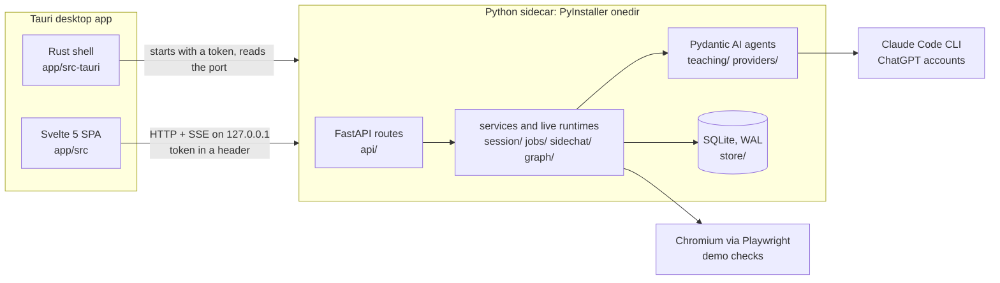

# Architecture

How Verstehen is built today: the processes, the package order, one turn from end to end, and a
map to the area docs. Each area doc covers its backend and frontend code together, so you only
need to read the area your task touches. What was decided, and why, is in [decisions](decisions.md).

## The system at a glance



- **One process owns the data.** The sidecar is the only reader and writer of the SQLite database
  (`<data dir>/verstehen.db`) and the data directory (`~/.local/share/verstehen`, or
  `VERSTEHEN_DATA_DIR`).
- **The shell stays thin.** [`app/src-tauri/src/lib.rs`](../app/src-tauri/src/lib.rs) starts the
  sidecar with a per-launch token, waits for its port line and a healthy `/api/health`, then shows
  the window. The webview may call one command, `sidecar_connection`.
- **Development and the app run on different machines.** Agents work on Pixal (Ubuntu) and build
  the Arch package in a container; the user installs it on the Arch laptop. See
  [tooling](architecture/tooling.md).

## Package order

The backend is `backend/src/verstehen/`, one package per LearnHarness topic. The order is enforced
by import-linter (`backend/pyproject.toml`):

```
api  →  session  →  jobs | sidechat | graph  →  teaching | providers  →  store
```

- A package imports only packages to its right. `session` calls `jobs`, `sidechat`, and `graph`
  directly; they reach a session only through plain functions injected at startup (for example
  `wake_session`, `before_side_ask`, `graph_changed`).
- **All wiring happens once**, in `create_app` in [`app.py`](../backend/src/verstehen/app.py). Read
  it to see which service gets which store, callback, and collaborator.
- ruff's banned-API rules keep `sqlite3`/`aiosqlite` in `store/` only, and keep Pydantic AI out of
  `api/`, `store/`, and `jobs/` outside `jobs/workers/`. Stored data and the API never contain
  Pydantic AI types.
- The frontend has its own boundaries (ESLint): only `src/lib/api/` uses `fetch` and the generated
  API types, `components/ui/` imports only itself, `#lib/utils`, and npm packages, and `src/lib/`
  never imports routes.

## The saved record and live state

- **The session record is an append-only entry log** (`entries` table, models in
  [`store/entries.py`](../backend/src/verstehen/store/entries.py)): `user`, `assistant`,
  `tool_result`, and `marker` entries, following LearnHarness's `LhMessage`. While a session
  exists its entries are never updated or deleted; a compaction or a delivered job result adds a
  marker. Deleting the session deletes its entries.
- **The model never sees the log directly.** [`session/projection.py`](../backend/src/verstehen/session/projection.py)
  (`to_llm_messages`) builds Pydantic AI messages from it before every run.
- **Derived, not stored:** the phase, the owed handoff, the current plan, the pending question,
  and plan-node statuses are all computed from the entries.
- **Live state is one `SessionRuntime` per session** ([`session/runtime.py`](../backend/src/verstehen/session/runtime.py)):
  the turn claim and lock, the live `TurnRun` with its replayable event log, the context-update
  queue, and the running compaction. Nothing in it is durable; after a restart the database holds
  everything needed to recover.
- **App-wide services** sit beside the runtimes: `JobRunner` with `WorkerAdmission` (the FIFO
  worker-request gate), `ExtractionService` (graph extraction), `SideChatService`, `TitleService`,
  and the `DeliveryService` that wakes idle sessions.

## One turn, end to end

A learner sends a message. The stages are methods of `TurnService` in
[`session/turns.py`](../backend/src/verstehen/session/turns.py); each returns `Refused(status, reason)`
or `Continue(state)`.

1. `POST /api/sessions/{id}/input` → `api/sessions.py` `input_session` → `TurnService.start`.
2. `validate`: under the runtime lock, read the entries, build the input's entries
   (`input_appends`), and refuse a second turn with 409. An answer that leaves sibling questions
   open is saved without a turn; a `continue` that isn't owed saves nothing and returns success.
3. `model_gate`: resolve the role's model (`ResolverService.resolve`, prober or teacher by
   `has_probe_done`) and ask `ProviderPolicy.admit` for foreground or background use.
4. `compaction_gate`: `CompactionService.ensure_compacted` summarizes first if the context is over
   the limit.
5. `claim_and_write_ahead`: claim the turn, add any side-chat updates, and save the input
   **before** inference. `turn-started` is published; the first message also starts the title.
6. `build_agent`: compose the prompt (`teaching/prompts.compose_instructions`) and build the prober
   or teacher with its tools and the `ContextUpdates` capability.
7. `run_background` → `run`: stream the agent (`agent.iter`) as an asyncio task. Every model
   request first runs `take_context_updates`, which injects queued job results, composer steers,
   and side-chat exchanges. Events go to the `TurnRun` log and out over
   `GET /api/sessions/{id}/stream`. A question tool defers, so the run ends with the question
   pending.
8. `settle` (the end of `run`, not a stage): save the new entries and plan blocks, release the claim, then publish
   `turn-settled`, so on the normal path "not running" means "saved". If saving fails, the error is
   published and the claim is still released. Follow-up work starts: an owed probe handoff, the
   compaction kick, delivery pumping, and graph extraction.

The UI side is the session controller ([`app/src/lib/session/controller.svelte.ts`](../app/src/lib/session/controller.svelte.ts)):
it posts the input, follows the stream, and adopts the saved record append-only when the turn
settles. Details: [session and turns](architecture/session.md).

## Area map

| Area | Doc | Backend | Frontend | LearnHarness spec |
|---|---|---|---|---|
| Session and turns | [session](architecture/session.md) | `session/` | `lib/session/`, thread, composer, session list | [turn lifecycle](learnharness/turn-lifecycle.md) |
| Teaching and questions | [teaching](architecture/teaching.md) | `teaching/` | `lib/questions/`, `lib/teaching/` | [teaching flow](learnharness/teaching-flow.md), [question tools](learnharness/question-tools.md) |
| Background jobs | [jobs](architecture/jobs.md) | `jobs/`, `session/delivery.py`, `teaching/job_tools.py` | `lib/jobs/` | [subagents and background work](learnharness/subagents-and-background-work.md) |
| Side chat | [side chat](architecture/sidechat.md) | `sidechat/` | `lib/sidechat/` | [side chat](learnharness/side-chat.md) |
| Knowledge graph | [graph](architecture/graph.md) | `graph/` | `lib/graph/`, `/graph` | [knowledge graph](learnharness/knowledge-graph.md) |
| Providers and models | [providers](architecture/providers.md) | `providers/` | `lib/models/`, model menu, Accounts, setup | [providers](learnharness/providers.md) |
| Storage | [store](architecture/store.md) | `store/`, migrations | — | [storage and events](learnharness/storage-and-events.md) |
| API and events | [API and events](architecture/api-and-events.md) | `api/`, `session/events.py` | `lib/api/` | [storage and events](learnharness/storage-and-events.md#event-flow-to-the-ui) |
| Frontend shell | [frontend shell](architecture/frontend-shell.md) | — | routes, layout, settings, markdown, Tauri shell | [overview](learnharness/overview.md) |
| Tooling and packaging | [tooling](architecture/tooling.md) | `cli.py`, `self_check.py`, fake model | verify flows | — |

Paths in the table are relative to `backend/src/verstehen/` and `app/src/`.

## Improvements over LearnHarness

Structure changes only; behavior stays the same unless [decisions](decisions.md) records a change.

1. **Named turn stages** instead of LH's single ~790-line `handleChatInput`.
2. **Event-driven delivery.** Asyncio events replace LH's polling and TTL guards. LH's
   `GRACE_MS` race is closed by design: a wake fires only from an idle runtime with no pending
   question, and an answer is saved and claimed in one runtime step.
3. **One question module**, `teaching/questions/`, instead of eight files.
4. **One context-update step** for job results, composer steers, and side-chat updates, each a
   named kind. The probe handoff is an explicit phase transition.
5. **No subscription staging.** `ProviderPolicy` is asked before a wake turn starts and before
   queued job results are injected; composer steers and side-chat updates are not gated. Automatic
   input is saved before dispatch, which differs from the recorded decision
   ([providers](architecture/providers.md), [known gaps](roadmap.md#known-gaps)).
6. **Derived state** for the phase, owed handoff, and plan, so a restart loses nothing.
