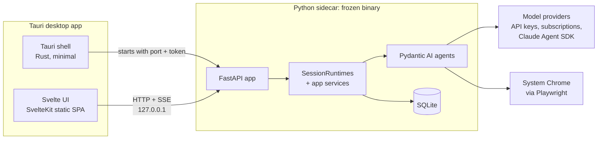

# Architecture

> Status: **first draft**, 2026-11-18. Statements marked **(Qn)** were decided by the user in the
> architecture session (also logged in [decisions](decisions.md)). Statements marked **proposal**
> are my design and still need review. Everything else is derived directly from the Part A docs.

## Readability principles

- Explicit state transitions
- Clear ownership of conversations, lessons, background work, and graph writes
- Small modules with concrete names
- Typed data at boundaries
- Abstractions only for demonstrated problems

## The system at a glance



- **One process owns the data.** The Python sidecar is the only reader and writer of the SQLite
  database and the data directory, like LearnHarness's "one server owner per data profile".
- **The Tauri shell stays thin.** It starts and stops the sidecar and shows the webview. App logic
  lives in Python and in the Svelte UI.

## Repository layout (Q6)

```
backend/                     Python project (uv)
  src/verstehen/
    api/                     FastAPI routes, SSE endpoints, auth token check
    session/                 SessionRuntime, turn handling, entry log, projection, compaction
    teaching/                prober / teacher / practitioner agents, question tools, plan tools
      prompts/               LearnHarness prompt tree, copied (Q14)
    jobs/                    job runner, steer delivery, recovery
      workers/               research, pdf, demo, visual
    sidechat/                side questions and their delivery to the main thread
    graph/                   extraction, audit, merge, BM25 candidates, imports, layout
    providers/               model resolution, provider policy, one adapter per kind
      claude_code/           vendored ClaudeCodeModel + VENDORED.md (Q10)
    store/                   SQLite connection, migrations/*.sql, one module per entity (Q5)
    config.py                data dir, environment
  tests/
app/                         Tauri + SvelteKit (Q7)
  src/                       SvelteKit SPA
    lib/api/                 generated API types (Q8) + client
  src-tauri/                 Tauri shell, sidecar config
docs/
```

Each package matches one Part A doc:

| Package | Owns | Part A doc |
|---|---|---|
| `session/` | the entry log, the turn claim, a turn's run from input to settlement, compaction | [turn lifecycle](learnharness/turn-lifecycle.md) |
| `teaching/` | the three agents, prompt composition, question tools, plan tools | [teaching flow](learnharness/teaching-flow.md), [question tools](learnharness/question-tools.md) |
| `jobs/` | job dispatch, workers, steer delivery, crash recovery | [subagents](learnharness/subagents-and-background-work.md) |
| `sidechat/` | side threads, side answers, delivery ledger | [side chat](learnharness/side-chat.md) |
| `graph/` | propositions, chains, coverage, sources, extraction pipeline | [knowledge graph](learnharness/knowledge-graph.md) |
| `providers/` | slots and roles, model resolution, subscription policy, usage | [providers](learnharness/providers.md) |
| `store/` | all SQL; nothing else imports `sqlite3` | [storage](learnharness/storage-and-events.md) |
| `api/` | HTTP shapes and SSE; no learning logic | [storage and events](learnharness/storage-and-events.md#event-flow-to-the-ui) |

**Proposal: dependency direction.** `api` → `session`, `sidechat`, `jobs`, `graph` → `teaching`,
`providers` → `store`. Lower packages never import higher ones. `teaching` doesn't know about HTTP
or SQLite: it receives what it needs as arguments.

## The session record (Q1)

The saved record is **Verstehen's own append-only entry log**, one row per entry. Pydantic AI
messages are built from it before every run and are never stored as the source of truth.

Entry kinds follow LearnHarness's `LhMessage` (`src/core/native-messages.ts`):

| Kind | Contents | Model sees |
|---|---|---|
| `user` | text, images | as a user message |
| `assistant` | text, thinking (with signatures), tool calls; provider, model, stop reason | as a model response |
| `tool_result` | the result of one tool call, including a learner's answer | as a tool return |
| `marker` | one of LH's marker types: `graph-context`, `probe-handoff`, `subagent-steer`, `subagent-abort`, `plan-block`, `practice-thinking`, `practice-next`, `problem-dismissed`, `compaction`, `side-question`, `side-question-told` | its canonical user text; `plan-block` is UI only |

(`plugin-problem-submission` is left out because plugins are deferred.)

- **Projection.** `session/projection.py` is the port of `toLlmMessages`. It is the one place that
  decides what the model sees: markers become their canonical text, plan blocks are dropped, the
  newest compaction marker's summary goes first and is followed by everything from its
  `firstKeptMessageId` onward, and a dangling tool call from an
  aborted turn gets the "interrupted" result.
- **Pending question.** A question is pending when the last assistant entry has a question tool call
  with no `tool_result` yet (LH's `questionCallsOf`). The answer run passes the projected history
  plus `deferred_tool_results` to Pydantic AI. *To confirm in the first milestone: the spike resumed
  from a saved `Conversation`; resuming from a rebuilt message history is the documented pattern
  but not yet tested.*
- **Append-only.** Entries are never updated or deleted. Compaction adds a marker. Each entry has a
  deterministic id where LH has one (`steer_<jobId>`, `exchange_<threadId>_update_<n>`, …), with a
  unique constraint, so a repeated write is harmless.
- **Steer acknowledgment.** Saving a turn's new entries and marking their steers as delivered
  happen in one transaction (spike lesson).

### SQLite tables (proposal)

| Table | Holds | LH equivalent |
|---|---|---|
| `sessions` | id, title, kind, created/updated, per-session model settings, plan tree (JSON) | `ChatRecord` fields |
| `entries` | session id, sequence number, entry id, kind, payload (JSON), created at | `ChatRecord.messages` |
| `usage` | one row per billed model call, keyed by request id | `turns`, `extractions`, `JobRecord.usage` |
| `side_threads`, `side_exchanges` | side chat threads and their exchanges | `ChatRecord.sideChats` |
| `jobs` | kind, status, input, result, delivery state, usage | `jobs/*.json` |
| `graph_nodes`, `graph_node_links` | propositions and their appended links | `nodes.jsonl` |
| `graph_chains` | chains merged by (premises, conclusion) | `chains.jsonl` |
| `graph_coverage` | per-message fingerprints | `coverage.jsonl` |
| `graph_checkpoints`, `graph_sources`, `graph_source_folders` | notes checkpoints, sources, organization | `sessions.jsonl`, `sources.json`, `source-organization.json` |
| `graph_positions` | layout positions (rebuildable) | `positions.json` |
| `settings` | key → JSON value | `settings.json` |
| `schema_migrations` | applied migration numbers | `format.json`, record versions |

- **Proposal:** WAL mode, one write connection owned by the store layer, and short transactions.
  Payload columns hold JSON validated by Pydantic models on the way in and out.

## Live state: SessionRuntime (Q3)

One `SessionRuntime` per open session replaces LearnHarness's per-chat `globalThis` registries.
A registry maps session id → runtime.

| Field | Replaces (LH) |
|---|---|
| turn claim (is a turn running, which one) | `turn-liveness.ts` |
| the live run handle (abort, reattach) | `turn-runs.ts` |
| the current turn's event log, for SSE replay | `ui-stream.ts` |
| the steer queue for this session | `jobs.ts` queues and live agents |
| running side answers | `side-chat.ts` |
| compaction in flight | `compaction.ts` |

- **Proposal:** one `asyncio.Lock` per runtime guards claim changes. State changes go through named
  methods (`claim_turn`, `release_turn`, `queue_steer`, …) so every transition is visible in one
  file.
- **App-wide services** stay separate and named: `ExtractionService` (running extractions and the
  audit lock), `WorkerAdmission` (the worker request queue), and `JobRunner`.
- **Nothing here is durable.** After a restart, runtimes are rebuilt empty, and the database holds
  everything needed to recover (write-ahead input, job delivery flags, coverage), as in LH.

## A turn, end to end

Port of the 13 stages in [turn lifecycle](learnharness/turn-lifecycle.md), in module terms:

1. `api` receives the input (message, answer, dismissal, `continue`, steer) and calls
   `session.turns.handle_input`.
2. The runtime claims the turn; a second turn on the same session is refused (409, as in LH).
3. The input entry is saved **before** inference (write-ahead).
4. `providers.resolve(role)` picks the model; `ProviderPolicy` admits the request (Q11).
5. `teaching` picks the agent (prober, teacher, or practitioner via `hasProbeDone`) and composes the
   prompt.
6. `session/projection.py` builds the message history from the entry log.
7. The run streams. A `before_model_request` hook delivers queued steers and side-chat updates
   before each model call. Events go to the runtime's event log and out over SSE.
8. A question tool raises `CallDeferred`; the run ends with the question pending.
9. New entries and steer acknowledgments are saved in one transaction.
10. The claim is released, then `turn-settled` is published, so "not running" always means "saved".
11. Extraction, compaction, and job wakes are started as follow-up work.

## Background work (Q4)

- **Jobs are asyncio tasks** in the sidecar, each running its own Pydantic AI agent. CPU-heavy steps
  (PDF rendering, resvg) run in a thread pool.
- **The `jobs` table** holds status, result, and delivery state. A job's result and its "ready to
  deliver" flag are written in one transaction.
- **Two ways a steer reaches the teacher** (as in LH): delivered live by the `before_model_request`
  hook if a turn is running, otherwise via an idle wake turn. Both use the deterministic
  `steer_<jobId>` id, so delivery happens at most once.
- **The demo worker** tests with Playwright driving system Chrome (decided earlier).

## Events to the UI (Q2)

FastAPI on `127.0.0.1`, keeping LH's two-stream model:

| Endpoint | Purpose |
|---|---|
| `POST /api/sessions/{id}/input` | start a turn with any input type |
| `GET /api/sessions/{id}/stream` | SSE: replay the current turn's event log, then live events until done |
| `GET /api/jobs?session=…` | job progress poll; also triggers the job recovery sweep, as in LH (decided) |
| `GET /api/events` | SSE: "something changed, refetch" notifications (LH's `ServerEvents` vocabulary, minus plugins) |
| ordinary JSON routes | sessions, entries, jobs, side chats, graph, settings, providers |

- **Auth.** Every request carries the per-launch token from the Tauri shell.
  **Proposal:** the UI reads SSE with `fetch` streaming (not `EventSource`), so the token travels in
  a header, not the URL.
- **Proposal: startup handshake.** Tauri generates the token and starts the sidecar with it. The
  sidecar binds to a free port and prints it on stdout; Tauri passes the port and token to the
  webview.

## Providers (Q11, Q12)

- `providers.resolve(role)` → the Pydantic AI `Model` plus metadata: provider kind, priced or not,
  context limit. Roles map to the strong / cheap / vision slots exactly as in LH.
- `ProviderPolicy.admit(request_purpose)` answers "may this request run now?" for foreground or
  background requests. Turns, side chat, jobs, and compaction call these two and never look at the
  provider kind.
- One adapter module per kind. **First implementation: Claude Code and ChatGPT only.** API key,
  Copilot, Grok, and custom endpoint adapters come in later milestones.
- **ChatGPT login** uses Pydantic AI's `openai-chatgpt` provider (checked in 2.70.0,
  `providers/openai_chatgpt.py`). It provides the OAuth flow (authorization code + PKCE, dynamic
  client registration, the one-shot loopback callback on `127.0.0.1:1455` via
  `exchange_code_from_callback()`) and handles token refresh. The app opens the browser and
  implements the `OpenAIChatGPTCredentialSource` protocol (`load()` / `save()`) on top of the
  credentials file.
- **Claude Code** is the vendored `ClaudeCodeModel` in `providers/claude_code/`, patched so the
  system prompt is **only our instructions**, with no Claude Code preset (Q10). `VENDORED.md`
  records the source commit (`8a78bdd`), the license, and every local patch.
- **Credentials** live in `<data dir>/credentials.json`, mode 0600, like LH's `auth.json` (Q12).
  Settings are in SQLite.

## Research, compaction, and search (decided)

- **Research search order:** the model's native web search, then Tavily, then Brave.
- **Compaction is always Verstehen's own**, ported from LH, with a user-set limit. Provider-native
  compaction isn't used, so summaries stay readable, learning-specific, and provider-independent.
- **Session search** uses an SQLite FTS5 index over entry text.

## Prompts (Q14)

- LH's prompt markdown tree is copied into `teaching/prompts/` unchanged, except the agreed 5–15
  node planning change.
- **Overrides** are files in `<data dir>/prompts/<segment path>.md`. An override file wins over the
  shipped one, as in LH.

## Frontend (Q7, Q8)

- **SvelteKit with `adapter-static` in SPA mode**, managed with **npm** (decided). No server-side rendering; all data comes from the
  sidecar.
- **Types are generated** from FastAPI's OpenAPI schema with `openapi-typescript` into
  `app/src/lib/api/`. SSE event payload models are included in the schema so they get types too.
- **Proposal:** a session controller module (port of LH's `components/session-core.ts`) owns send,
  attach, recover, and the append-only merge of saved entries (`adoptRecord`).

## Packaging and data (Q9, Q15)

- **Release:** the Python server is frozen with PyInstaller and shipped as a Tauri sidecar
  (`externalBin`). No browser is bundled: Playwright uses system Chrome.
- **Development:** the server runs with `uv run`, the UI with the Tauri dev server.
- **Data dir:** `~/.local/share/verstehen` by default, overridable with `VERSTEHEN_DATA_DIR`. Tests
  and development always use a separate directory.

## Testing (Q13)

- uv for the environment, ruff for lint and format, pyrefly for type checking (decided).
- pytest, with Pydantic AI's `FunctionModel` scripting the model's replies, a real temporary SQLite
  database, and no network.
- Each Part A behavior gets a test named after it: question pause and answer, sibling questions,
  dismissal, steer delivered exactly once, side-chat delivery, graph merge rules, compaction.
- Tests against real models are opt-in only.

## Agent framework boundary

- Pydantic AI types appear only in `teaching/` (agents, tools), `session/projection.py`, the run
  loop in `session/`, and `providers/`.
- The entry log, the database, the API, and the UI never contain Pydantic AI types (Q1).

## Open questions

- **Later providers (not needed for the first implementation).** Pydantic AI 2.70.0 has a GitHub
  Copilot device-code flow (`_github_copilot_oauth.py`; storage left to the caller). Its `xai`
  provider is **API key only**, so a Grok subscription login has no Pydantic AI support and would be
  our own code.
- **Not yet discussed** (each needs a decision before its milestone):
  - **Agent-generated HTML in the app.** Demos are model-written HTML (LH `components/artifacts/demo-card.tsx`
    renders them in a sandboxed iframe). Sandbox and CSP rules inside the Tauri webview.
  - **Python libraries** replacing LH's JS ones: PDF rendering and text (LH: `pdfjs-dist` + Skia),
    SVG rasterizing (LH: `@resvg/resvg-js`). License matters here (PyMuPDF is AGPL).
  - **UI rendering libraries** replacing LH's React ones: the graph view (LH: `@xyflow/react`,
    `d3-force`, `dagre`), math (KaTeX), Mermaid, and Markdown streaming.
  - **Images and the vision slot** with the first two providers (learner image attachments, the
    visual worker). The vendored `ClaudeCodeModel`'s support for image parts is untested.
  - **Context window sizes** for Claude Code and ChatGPT models: where they come from (a catalog,
    the provider, or a setting). They cap the compaction limit and size the side-chat budget.
  - **Spike: Claude Code's built-in WebSearch** for the research worker through the vendored
    adapter (decided to try; see decisions).
  - **Logging and debugging**: logs, LH's provider-event recording, and Pydantic AI's Logfire banner.
  - **Rest of the tooling**: Python version, the test and check commands, CI, and an `AGENTS.md` for
    the Verstehen repo (uv, ruff, and pyrefly are decided).
- **Review the proposals above:** dependency direction, SQLite tables, SessionRuntime lock and
  methods, SSE via `fetch`, the startup handshake, and the session controller.
