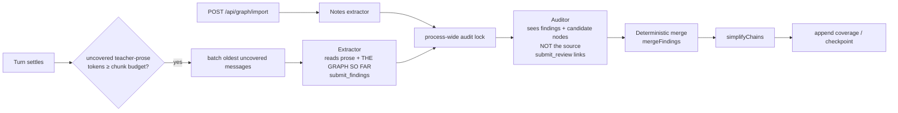

# Knowledge graph and imports

> Status: **first draft**. LearnHarness commit `a636647`. All statements describe **current
> behavior** unless marked.

The knowledge graph is a **global, cross-session** record of the *true ideas* that teaching
sessions and imported notes have covered, together with the reasoning that connects them.

**It does not record the learner's understanding.** It holds no quiz outcomes and no mastery
levels. The design comment at `src/core/contracts/graph.ts:1-18` states this explicitly. The
graph is built **after the fact** by an extraction pipeline, and it is independent of the session's
plan tree.

## Data model

Types are in `src/core/contracts/graph.ts`.

### Proposition (`GraphNode`, `:113`)

| Field | Meaning |
|---|---|
| `id` | `n_…`, assigned by the store |
| `name` | very short label, like a glossary headword, shown on the canvas; not unique |
| `statement` | **the identity anchor**: one true, self-contained, world-facing statement at full precision |
| `aliases` | wordings that other sessions used for the same idea |
| `provenance` | every `{ chatId, messageId }` where it came up. `chatId` can be a notes source `src_…`; `messageId` is `""` for chat-level or file provenance |

### Reasoning chain (`GraphChain`, `:37`)

| Field | Meaning |
|---|---|
| `id` | `arg_…` |
| `premises` | node ids that **jointly** entail the conclusion (at least one) |
| `conclusion` | node id |
| `provenance` | where this argument was asserted |

Independent arguments for the same conclusion are separate chains. Deleting a proposition
deletes the chains that use it.

### Derived, not stored

`graphSnapshot` (`src/core/graph.ts:510`) builds these on every read:

- **Edges.** A single-premise chain becomes a direct arrow. A multi-premise chain becomes
  premise → *implication node* (with the chain's id) → conclusion.
- **Clusters** (`Cluster`, `:273`; `src/core/session-clusters.ts`) group each proposition by its
  **birth session**, the `chatId` of its first surviving provenance point. No embeddings and no
  community detection are involved. Hulls are drawn for clusters with at least 3 members.
- **Positions** come from a separate rebuildable ledger written by layout settling. Camera state is
  device-local *(per LH docs)*.

### Storage

Append-only JSONL ledgers under `data/graph/`:

| File | Content |
|---|---|
| `nodes.jsonl` | one line per node assertion. The **first line for an id defines** `name`, `statement`, and `createdAt`. Later lines are *link-appends*: their statement and aliases join `aliases`, and their provenance is unioned in (`getGraph`, `graph.ts:406`). |
| `chains.jsonl` | one line per chain assertion. Lines are merged by `(premises, conclusion)` at read time. |
| `coverage.jsonl` | `CoverageEntry { chatId, fp, tokens, foldedAt }`, one per extracted teacher message (`:148`) |
| `sessions.jsonl` | `SessionCheckpoint`, a whole-source checkpoint used for notes imports |
| `sources` map, `source-organization.json`, positions, render settings | JSON maps |

> **Caution: the comments have drifted.** The header comment at `contracts/graph.ts:157-190` still
> mentions "follows/supports edges" and an auditor that "may draw BRIDGING edges". The current
> types say the opposite: storage is **chains-only**, and the auditor submits **identity links
> only** (`AuditVerdicts`, `:267`). This doc follows the types and code.

## The extraction pipeline

Code: `src/agent/subagents/extraction.ts` (`createExtractionPipeline`, `:797`). It's one instance,
shared by both entry points (`src/server/chat-handler.ts:132-148`).

### 1. Trigger and coverage

- **When it runs.** After every non-practice turn, if `graph.enabled` is on, `triggerExtraction`
  (`src/server/turn-service.ts:109`) computes coverage. It starts a fire-and-forget run when the
  uncovered tokens reach `graph.extractionChunkTokens` (default **4096**, `src/core/settings.ts:553`;
  minimum 500 *per LH docs*).
- **What counts.** Only **teacher prose**, meaning user-facing text in assistant messages, including
  `send_to_user` (`messageViewLines`, `src/core/coverage.ts:38`). Learner text, questions, tool
  results, and markers don't count.
- **How coverage is tracked.** A message is covered when its view's SHA-256 fingerprint is in
  `coverage.jsonl` (`messageFingerprint`, `:77`; `coverageOf`, `:115`). A message whose text changes
  is uncovered again.
- **Batching.** `batchRuns` (`:159`) batches the oldest uncovered messages without splitting a
  message. Batches from one source run **serially**.
- **Settings scope.** Manual extraction and import routes don't check the automatic-extraction
  switch *(per LH docs)*.

### 2. Extractor

- **Input.** It reads the batch as plain teacher prose, plus **"THE GRAPH SO FAR"**: a digest of
  what this source has already produced (`sourceDigest`, `:470`). It should build on existing ids
  instead of restating them.
- **Prompt rules** (`EXTRACTION_CORE`, `:403-428`; `EXTRACTOR_INSTRUCTIONS`, `:436`):
  - **Entailment only.** A chain needs premises that jointly entail the conclusion. Historical or
    narrative connections don't count.
  - **True knowledge only.** Never record anything about the learner, the teacher, or the session.
    A misconception enters as its *true correction*.
  - **Standalone.** No reliance on the source's own scaffolding, such as numbering or labels.
  - **Core ideas.** Extract the load-bearing ideas, the things a reference on the subject would
    teach, not every example.
  - Each new proposition gets the `messageId` of the passage it came from.
- **Output.** One `submit_findings` call returns `{ propositions: [{ id: "p1", name, statement,
  aliases, messageId? }], chains: [{ premises, conclusion }] }` (`ExtractedProposition`, `:198`;
  `ExtractedChain`, `:234`). Chain endpoints can be new local ids or existing `n_…` ids.
- **Validation.** The submit is schema-validated, with healing for common model mistakes
  (`healStringifiedArrays`, `subagents/submit-agent.ts`). Chains and anchors are checked against the
  batch (`validateFindingsChains`, `validateSessionAnchors`, `:312-364`).
- **Notes variant.** The extractor for notes (`NOTES_EXTRACTOR_INSTRUCTIONS`, `:446`) is more
  inclusive: it keeps definitions, formulas, and facts without derivations.

### 3. Auditor (reconciliation)

Prompt: `AUDITOR_INSTRUCTIONS` (`:559`). Loop: `runAuditor` (`:587`), at most 16 turns.

- **What it sees.** The **findings plus about 5 ranked candidate nodes per finding**. It **never sees
  the source**.
- **Tools.** `find_candidates`, `list_sessions`, and `list_propositions` (`src/agent/tools/graph.ts`)
  let it look up specific missing candidates.
- **Its job.** Decide for each finding whether an existing node already represents its main idea.
  The bias is toward linking: link paraphrases, compressions, and different explanations of the same
  point. "Shared subject matter alone is not a match."
- **Output.** `submit_review { links: [{ id, linkTo }] }`. Omitted findings become new nodes. It never
  rejects findings and never creates edges.

### 4. Merge (deterministic)

`mergeFindings` (`src/core/graph.ts:149`) does three things:

1. **Resolve.** A linked finding becomes a link-append to the existing node: its wording becomes an
   alias and its provenance is added. An unlinked finding gets a new `n_…` node. Chain endpoints
   are mapped to node ids, and chains are appended.
2. **Simplify.** `simplifyChains` (`:301`) removes redundant derivations: chains for the same
   conclusion whose premises add nothing that a leaner kept chain doesn't already give. The chain
   ledger is rewritten if anything was dropped.
3. **Checkpoint.** Only after every append has succeeded does it write coverage entries, or the
   notes checkpoint. A failure leaves the batch uncovered, so it will be retried later.

### Concurrency and failure

- **Audit lock.** A process-wide FIFO lock serializes **audit through merge** (`withAuditLock`), so
  the auditor always sees a stable graph. Extractors for different sources can overlap.
- **Usage.** Usage is logged to `ChatRecord.extractions`, or to the source's `extractions` for notes.
- **Abort.** `abortExtraction` (`:702`), from the activity dock.
- **Not transactional.** Multi-file writes aren't atomic. Completed batches survive a later failure
  *(per LH docs)*.

## Source import

`POST /api/graph/import` (`app/api/graph/import/`), using `NotesImportInput` (`extraction.ts:747`):

- **Input.** Text files, or PDFs converted locally to Markdown (`subagents/pdf-markdown.ts`; no OCR).
  Notes go through the same extractor → auditor → merge path, with the notes prompts.
- **Source identity.** `src_` plus a hash of the original path (`NotesSource`, `contracts/graph.ts:80`).
  Re-importing the same path reuses that identity, and every import processes the **whole file**.
- **Limits** *(per LH docs)*: 25 MiB per file, an extension allowlist, and a binary-file heuristic.
  The UI uploads at most three at once.
- **Organization.** `source-organization.json` stores display names and folders, never file
  contents.

## Who writes to the graph

| Writer | Writes |
|---|---|
| Extraction pipeline (`mergeFindings`) | nodes, chains, coverage, checkpoints — the *construction* writer |
| Source deletion (`app/api/graph/sources/`, `core/graph-deletion.ts`) | removes a source's contributions and keeps knowledge supported elsewhere. Deleting the source's conversations too is optional and off by default. |
| Node deletion (`app/api/graph/nodes/`) | removes a proposition and its chains |
| Session deletion | can keep the graph (keeps provenance, drops extraction bookkeeping) |
| Layout settle (`app/api/graph/positions/`) | positions ledger |

## How teaching uses the graph

- **Prober:** `list_sessions` and `list_propositions` (graph readers) let it see what earlier
  sessions established. They're only available when **both** `graph.enabled` and `agent.graphTools`
  are on (`graphToolsEnabled`, `chat-handler.ts:787`).
- **Teacher:** **no** graph tools.
- **Practice:** graph readers (same gate). Problems target proposition ids, validated against the
  whole graph (`chat-handler.ts:745`).
- **Session-start picks.** When creating a session, the learner can pick propositions and chains.
  These are injected as a `graph-context` marker (`newGraphContextMessage`,
  `src/core/native-messages.ts:322`) that begins *"[Session context] — picked from the learner's
  knowledge map…"*. There's no automatic semantic retrieval.

## Graph UI

- **Canvas** (`components/graph-view.tsx`, `components/graph-canvas.ts`) renders the snapshot.
- **Chains table** (`components/chain-table.tsx`) lists chains.
- **Node detail cards** show the statement, aliases, and provenance links back into sessions.
- **Coverage indicator** (`components/extraction-coverage.tsx`) shows how much of the session has been
  extracted.
- **Routes** are under `app/api/graph/`: `route.ts` (snapshot), `nodes`, `sources`, `import`,
  `coverage`, `positions`, `render-settings`, `status`, `costs`.

*The UI behavior above was located by file name and LH docs, and hasn't been traced in component
code.*

## Port notes

- **The model is clean and worth keeping exactly:** propositions, jointly-entailing chains, an
  append-only ledger merged at read time, and derived edges and clusters. "True ideas only, never
  the learner" is a strong invariant.
- **The three-stage split is the core of reconciliation:**
  1. the extractor sees the source;
  2. the auditor sees only the findings and candidates;
  3. a deterministic merge.

  Port it stage by stage with the prompts verbatim.
- **Coverage by content fingerprint** makes extraction idempotent and restartable. Keep it.
- **Decided: one authoritative description per concept.** The drifted comments in LearnHarness are
  the reason: in the port, each concept is described once (these docs plus a test named after the
  behavior), with few comments repeating it. Check this doc against LearnHarness's tests
  (`tests/extraction*`) before porting.
- **Concurrency** relies on in-process locks and `globalThis` registries in LearnHarness. **Decided:**
  with SQLite, the merge plus coverage checkpoint is **one transaction**, an implementation
  improvement that keeps the same behavior.
- **Candidate ranking for the auditor** (`createPropositionCandidateSearch`,
  `src/core/proposition-candidates.ts:75`) is plain **lexical BM25** (k1 = 1.2, b = 0.75) over each
  node's name + statement and each name + alias, scored separately. It drops English stop words and
  doesn't use embeddings. Results are paged 5 at a time (`CANDIDATE_PAGE_SIZE`). The auditor's
  `find_candidates` tool can add extra "hint" words. Scores only rank candidates; the auditor makes
  the identity decision. It's simple to port exactly.
