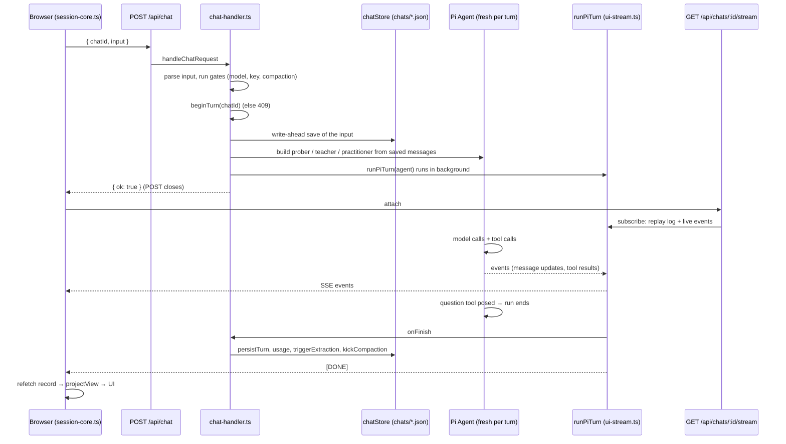

# LearnHarness overview

> Status: **first draft**. Describes LearnHarness at commit `cb25c8e`.
> Unless marked otherwise, every statement is **current behavior**. Paths are relative to the
> LearnHarness repository root. A statement taken from LearnHarness's own
> `docs/architecture.md` rather than checked in code is marked *(per LH docs)*.

## In one paragraph

LearnHarness is a Next.js app, with an optional Electron desktop shell. The **server** owns
everything that matters: agent runs, the saved conversation, background workers, and the
knowledge graph, all stored as JSON/JSONL files. The **browser** is a view. It posts learner
input, attaches to a stream of agent events, and renders a projection of the saved
conversation. The agent loop itself comes from the **Pi** libraries
(`@earendil-works/pi-agent-core` and `pi-ai` 1.4.0, see `package.json:30-31`). LearnHarness
builds a fresh Pi `Agent` for every turn from the saved transcript.

Markdown tables hug their contents; wide body text wraps to the available column. Tables whose
minimum content width still exceeds the column (for example unbreakable code or URLs) use the
existing horizontal scroller (`app/globals.css:359-370`).

## Main parts

| Layer | Folder | What lives there |
|---|---|---|
| UI | `app/` (pages), `components/` | React UI. `components/session-core.ts` is the browser-side session controller (send, attach, recover). |
| HTTP | `app/api/` | Thin route files that call into `src/server`. Example: `app/api/chat/route.ts` is 5 lines. |
| Server | `src/server/` | Composition root and turn orchestration (`chat-handler.ts`), the turn registry and liveness, job delivery (`jobs.ts`), compaction, the side-chat service, and provider glue. |
| Agent | `src/agent/` | Agent construction (`teacher-agent.ts`), the tool registry (`tools.ts`, `tools/`), background subagents (`subagents/`), prompts (`prompts/`), and provider bridges. |
| Domain | `src/core/` | Data types and pure-ish logic: message model (`native-messages.ts`), input parsing (`input-events.ts`), view projection (`view.ts`), graph (`graph.ts`), coverage, plans, and questions. |
| Storage | `src/store/` | Filesystem adapters: `chats.ts`, `jobs.ts`, `graph.ts`, `settings.ts`, `auth.ts`, and others. |

Import rules between layers are enforced by `eslint.config.mjs` *(per LH docs)*.

## The central data: `ChatRecord`

One session is one JSON file holding a `ChatRecord` (`src/core/contracts/chat.ts:24`):

- `messages: LhMessage[]` is the transcript in **Pi's native message format**: user, assistant,
  and tool-result messages. It also includes app-specific "marker" messages, each with an `id`
  (`src/core/native-messages.ts:104`). **The record is the agent state.** No separate agent
  memory exists.
- `kind` is `practice` or absent. Absent means a teaching session.
- `tree` is the lesson plan, written by the `plan_init` tool.
- `sideChats` holds the side-question threads (see [side chat](side-chat.md)).
- `turns` and `extractions` are append-only usage and cost logs.
- `settings` holds per-chat model and thinking overrides.

The record has two projections:

- `toLlmMessages` (`src/core/native-messages.ts:653`) produces what the **model** sees. It strips
  app metadata, applies the compaction cut, and repairs interrupted tool pairs.
- `projectView` (`src/core/view.ts:142`) produces what the **UI** shows: messages, the question
  dock, and artifact cards.

## Three agents, chosen from the transcript

Each turn builds one of three Pi agents (`src/agent/teacher-agent.ts`):

| Agent | Built when | Core tools |
|---|---|---|
| **Prober** (`createProberAgent`, `:338`) | teaching session, no `probe_done` in the transcript yet | `probe` (or `recall` under free-recall mechanics), `ask_user_question`, `probe_done`, files, research/PDF jobs, optional graph readers |
| **Teacher** (`createTeacherAgent`, `:348`) | teaching session, after `probe_done` | `quiz` (or `explain` under free-recall), `ask_user_question`, `plan_init`, files, research/PDF/demo/visual jobs, `show_image` |
| **Practitioner** (`createPracticeAgent`, `:401`) | `kind: "practice"` | `problem`, `conclude`, plus research/PDF and optional graph readers |

The switch is decided purely from the saved messages: `hasProbeDone(agentMessages)` at
`src/server/chat-handler.ts:643`. No separate "phase" field exists. The system prompt is
composed fresh per turn from prompt fragments (`composeInstructions`, `teacher-agent.ts:87`).

## A learner action, end to end

This traces what happens when the learner sends a message or answers a question.

Step by step:

1. **Browser posts input.** `SessionCore.send` / `postInputEvent`
   (`components/session-core.ts:861`, `:558`) sends `POST /api/chat` with `{ chatId, input }`.
   The input is a tagged union (`src/core/input-events.ts:63-86`): `text`, `answer`
   (the answer to a question tool call), `thinking`, `continue`, `retry`, `retry-question`,
   `steers`, plus plugin variants.
2. **Route → handler.** `app/api/chat/route.ts` calls `handleChatRequest`
   (`src/server/chat-handler.ts:184`). That parses the input and calls `handleChatInput` (`:214`).
3. **Gates, before anything is written** (`chat-handler.ts:279-429`):
   - a model must be configured (else 503);
   - the provider key or subscription must be present (else 503);
   - images are prepared;
   - **compaction** must finish if the transcript is over its token threshold (`ensureCompacted`,
     `:386`).
4. **One turn per chat.** `beginTurn(chatId)` (`:562`, `src/server/turn-liveness.ts:59`) claims
   the chat. A second concurrent request gets **409**.
5. **Write-ahead save.** The input is converted to native messages (`inputAppends`) and saved
   to disk **before** the model runs (`chat-handler.ts:569-611`). An answer survives a crash.
6. **Build the agent.** One of the three agents is built from the saved messages, with that
   turn's tools and prompt (`:734-790`). The live agent is registered with the job-delivery
   system (`registerLiveAgent`, `:809`) so background results can be injected into this run
   (see [subagents](subagents-and-background-work.md)).
7. **Run in the background.** `runPiTurn` (`src/server/pi/ui-stream.ts:130`) starts the Pi agent
   loop as a server-side object, independent of the HTTP request. The POST returns
   `{ ok: true }` immediately (`chat-handler.ts:970`).
8. **Browser attaches to the stream.** `GET /api/chats/:id/stream`
   (`app/api/chats/[id]/stream/route.ts`) replays the turn's event log so far, then streams
   live events until `[DONE]`. With no running turn it returns a "settled" terminal and the
   browser refetches the record. Closing the tab detaches the view without stopping the agent.
9. **Agent loop.** Pi calls the model, executes tools, and loops. A **question tool** (`quiz`, `probe`,
   `ask_user_question`, and so on) returns a synthetic "question posed" placeholder with
   `terminate: true`, which **ends the run**. The placeholder is never saved. The learner's later
   answer becomes that tool call's real result in the next POST (`src/agent/tool-execute.ts:15-35`,
   `teacher-agent.ts:160-185`). See [question tools](question-tools.md).
10. **Settlement** (`onFinish`, `chat-handler.ts:860-949`), in this order:
    1. `persistTurn` saves the new messages.
    2. The usage entry is appended.
    3. `triggerExtraction` may start knowledge-graph extraction in the background.
    4. The parked dismissal is applied.
    5. The turn claim is released.
    6. Leftover steers are reconciled.
    7. `kickCompaction` may start compaction in the background while the learner reads.

## Things that run beside a turn

| Mechanism | What it is | Doc |
|---|---|---|
| Background jobs | research, PDF, demo, and visual subagents started by tools. Results come back as "steer" markers, injected into a live run or waking an idle session (`src/server/jobs.ts:229`). | [subagents](subagents-and-background-work.md) |
| Side chat | a separate, tool-less model call per side thread (`src/server/side-chat.ts:63`). Its exchanges are later appended into the main transcript as `side-question` entries. | [side chat](side-chat.md) |
| Extraction | after a turn, uncovered teacher prose is extracted into propositions and chains, then audited and merged into the graph (`src/agent/subagents/extraction.ts:797`). | [knowledge graph](knowledge-graph.md) |
| Compaction | summarizes old history when it exceeds a token threshold. It runs before or after turns and never during one. | [turn lifecycle](turn-lifecycle.md) |
| Window events | `/api/events` is a process-local "something changed, refetch" signal, with no durable replay *(per LH docs)*. | [storage and events](storage-and-events.md) |

## Glossary

- **Turn**: one server-side Pi agent run, from accepted input until it stops (a question was
  posed, the agent finished, it was aborted, or it errored). It can span several model calls
  and tool calls.
- **Engine** (`PiEngine`): a resolved model, stream function, and thinking level.
- **Marker message**: an app-specific entry in the transcript. Examples: handoff, plan block,
  steer, side-question, graph context.
- **Steer**: a message injected into a running agent (job results, composer messages sent
  mid-turn) or used to wake an idle session.
- **Write-ahead**: input is saved before inference starts.
- **Settlement**: the `onFinish` sequence that saves the turn's output.
- **Coverage**: which teacher messages have already been extracted into the graph.

## Port notes

Outcomes are recorded in [decisions](../decisions.md) and [architecture](../architecture.md).

- **`chat-handler.ts` is the main complexity hotspot.** `handleChatInput` is a single ~790-line
  function covering validation, gating, compaction, write-ahead persistence, agent construction,
  side-chat budgeting, subscription admission, and settlement. **Decided:** the port splits it into
  named stages (see [turn lifecycle](turn-lifecycle.md#port-notes)).
- **"The record is the agent state" is kept.** Phase is derived from the transcript (`probe_done`),
  not stored: one source of truth. The port's record is its own append-only entry log, projected to
  Pydantic AI messages before each run.
- **The question-stop contract is central.** Pydantic AI covers it with deferred tools
  (`CallDeferred`), including mixed tool batches (confirmed by spike).
- **Much of the incidental complexity comes from provider variety** (subscriptions, CLI bridges,
  per-provider admission) and plugins. Plugins are deferred. The first implementation has two
  providers, Claude Code and ChatGPT.
- **Module-global state** (the turn registry, the steer queues, `globalThis` registries) does the
  coordination inside one process. **Decided:** one `SessionRuntime` per session owns it.
