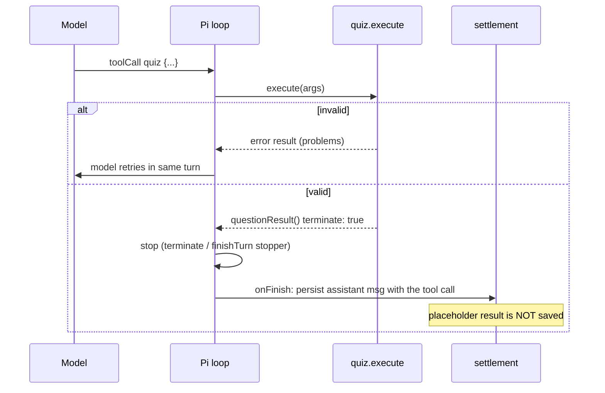

# Question tools

> Status: **first draft**. LearnHarness commit `a636647`. All statements describe **current
> behavior** unless marked.

Question tools are how the agent asks the learner something and **waits** for the answer. They
are the main way the prober, teacher, and learner take turns.

## Available question tools

`QUESTION_TOOLS` (`src/core/pending.ts:53`) lists five names. They map onto three
"kinds" (`toolQuestionKind`, `pending.ts:63`):

| Tool | Agent | Kind | Answer form | Graded by |
|---|---|---|---|---|
| `probe` | prober | quiz | multiple choice (single/multi) + confidence | browser (deterministic) |
| `recall` | prober (free-recall mode) | explain | learner's own words | model, against its committed answer |
| `quiz` | teacher | quiz | multiple choice + confidence | browser |
| `explain` | teacher (free-recall mode) | explain | own words | model |
| `ask_user_question` | prober and teacher | ask | free text, or options + "Other" | not graded |

- A settings switch (`explain: true`, "quizzing mechanics") chooses between multiple-choice and
  free recall. An agent has **one** quizzing tool at a time. See `quizMechanics` and the
  registries in `src/agent/tools.ts:303-314` (prober) and `:439-446` (teacher).
- Probe-phase and teach-phase tools are separate names so the transcript shows the phase
  boundary.
- Question tools are **not toggleable**; only the job tools are (`TOGGLEABLE_TOOLS`,
  `pending.ts:87`).

### Arguments

The schemas are in `src/core/question-core.ts`.

- **Probe quiz** (`quizInputBase`, `:160`) takes:
  - `question`;
  - `options[]` (at least 2, each with a stable `value`);
  - `multiSelect?`;
  - `explanation` (shown after answering, and written *before* the answer by design);
  - `correctAnswer` (option value or values);
  - `details?`.

  The model must not add its own "I don't know" option, because the UI adds one.
- **Teach quiz** (`quizInputObject`, `:258`) takes the same fields plus two that come **first**
  so the model doesn't drop them:
  - `type` is `predict` (posed *before* teaching a step) or `check` (posed *after*).
  - `nodeId` is the plan-tree node the question is about.

  The lesson's position on the plan map is **derived** from these tags.
- **Explain / recall** (`explainInputObject`, `:328`) has no options. The model writes a full
  `correctAnswer` commitment before posing. This guards against sycophancy: the model can't
  quietly move the goalposts after seeing the learner's answer.
- **Ask** (`askInputSchema`, `:369`) takes `question`, `details?`, optional `options[]` and
  `multiSelect?`. With options present, the learner can still pick "Other".

### Validation

1. **Structural:** Pi validates arguments against the TypeBox schema before `execute` runs
   (`src/agent/tool-execute.ts:29-34`).
2. **Semantic**, inside `execute`:
   - `quizInputProblems` checks that a `correctAnswer` matches an option;
   - `nodeIdProblem` checks that `nodeId` exists in the current plan tree
     (`teachQuizToolFor`, `src/agent/tools.ts:376-392`).

   Problems return an **error tool result** (`invalidInputResult`). The model sees the list
   and retries within the same turn.
3. **Argument healing** runs first (`prepareArguments: prepareQuestionArguments`,
   `healToolRecord`). It repairs common model mistakes such as options sent as a JSON string or
   quoted enum values.

## How a question stops the run

- A valid question returns `questionResult()` (`src/agent/tool-execute.ts:222`). Its text is
  *"Question posed — the turn ends here…"* and it carries `details: null` and **`terminate: true`**.
  That ends a single-question batch natively in Pi.
- When one assistant message contains a question plus other tool calls (a "mixed batch"),
  `terminate` alone would let the loop continue. `makeQuestionStopper`
  (`src/agent/teacher-agent.ts:160-202`) is installed as Pi's `finishTurn` hook. It stops the
  run when every question call in the message succeeded. If any question call errored, the run
  continues so the model can fix it. The practitioner's `problem` tool follows the same rule.
- The placeholder result is **never persisted**. The saved record keeps the assistant's tool
  call with **no result**, and that unanswered call is what "pending question" means.

## Finding the pending question

The pending question is derived from the transcript every time; it is never stored as a flag.

- `questionCallsOf(messages)` (`src/core/native-messages.ts:862`) looks only at the **newest
  assistant message**. It returns every question call in that message with no matching tool
  result, each with a status:
  - `streaming`: still being generated;
  - `answerable`: valid, waiting for the learner;
  - `malformed`: truncated or invalid arguments;
  - `failed`: the generation errored or was aborted.
- `danglingQuestionOf` (`:812`) is the server's view: the first `answerable` call.
- `pendingQuestionOf` (`:823`) is the browser's view. It also ignores the live placeholder.
- `hasUnresolvedQuestion` (`:885`) answers "is anything still waiting on the learner?". Many
  other systems check it: background job delivery, side-chat delivery, compaction projection,
  and the composer gate.

## How the answer gets back to the agent

1. **The browser renders the question dock** (`components/question-dock.tsx`). Quiz options are
   **shuffled deterministically**, seeded by the tool-call id (`question-dock.tsx:311`), so
   every reload shows the same order.
2. **The browser builds the answer** with `buildAnswer` (`src/core/question-core.ts:712`), called
   from `components/question-dock.tsx:464` and `components/chat.tsx:736`.
   - **Quiz:** the browser grades it by comparing the selected option indices with
     `correctIndices` (`isCorrect`). It records `correct`, `confidence` (0–100, snapped to
     `CONFIDENCE_STOPS` = 0/30/50/70/90/100; never sent on "I don't know"), `explanation`, and
     `correctIndices` for rendering.
   - **Explain:** not graded. The browser attaches the model's `committed` answer for the reveal.
   - **All kinds** carry two separate learner text channels:
     - `thinking` is reasoning about the question;
     - `readingThinking` is thinking while reading the teaching prose, and appears only on
       teach-phase checks.

   The browser can grade because the tool call's arguments, including `correctAnswer`, are in
   the saved transcript it reads.
3. **The browser POSTs `{ type: "answer", toolCallId, answer }`** to `/api/chat`
   (`src/core/input-events.ts:64`).
4. **The server turns it into a tool result.** `inputAppends` (`input-events.ts:299`) checks that
   `toolCallId` is the dangling question, then calls `newAnswerResult`
   (`native-messages.ts:249`). That creates a `toolResult` message with two parts:
   - `content` is what the **model** reads: `compactAnswerForModel(answer)`
     (`question-core.ts:783`). That's only what the learner added: the selection, `correct`,
     `confidence`, `thinking`, `thinkingWhileReading`, plus `dontKnow` or `dismissed` when they
     apply. The question, options, and correct answer aren't repeated, because the model already
     wrote them in the call.
   - `details` is the full `QuestionAnswerData`, for the UI and the record.
5. **The normal turn path follows** ([overview](overview.md)): write-ahead save, then a fresh agent
   whose history now ends with *assistant tool call → tool result*. The model reacts to the answer
   as if the tool had just returned.

## Several questions in one message ("siblings")

Some models emit two or more question calls in one assistant message. Providers reject a tool
result placed after an unrelated assistant message, so **all results must sit directly after
their calling message**.

- An answer that still leaves a sibling pending is **saved without starting a turn**
  (`src/server/chat-handler.ts:537-557`). The handler saves it, emits `record-changed`, and
  returns a "settled" response. The dock moves on to the next question.
- The **last** answer starts the one reaction turn, with every result adjacent to its call.
- Nothing else can generate while a question is pending, so adjacency always holds.

## Dismissal (Esc)

`POST /api/chats/:id/dismiss` (`app/api/chats/[id]/dismiss/route.ts`) records a dismissed answer
(`dismissedAnswer`, `question-core.ts:772`). The model sees `{ kind, dismissed: true }`.

- It **wakes nothing**: no turn starts and no tokens are spent. The session enters a "dismissal
  pause", during which job deliveries wait.
- The learner's next plain message is the wake that carries the dismissal, plus any held job
  results, into the agent's context.
- If a turn is running, the dismissal is **parked** and applied during that turn's settlement
  (`applyParkedDismissal` in `chat-handler.ts`).

## Malformed questions: `retry-question`

If a question call is `malformed` (truncated or invalid arguments that slipped through, for
example on older records), the learner can ask for a replacement. `retry-question`
(`questionRecoveryAppends`, `input-events.ts:380`) appends an error result: *"…could not be
displayed as a complete question. The learner requested a replacement…"*. The model then
re-issues the question.

## Interaction with queued background results

- While a question is pending, **background job results don't wake the session**. They wait in
  the steer queue (see [subagents](subagents-and-background-work.md)).
- When the learner answers, the handler registers the new run's agent **before** starting it
  (`registerLiveAgent`, `chat-handler.ts:809`, and the comment at `src/server/jobs.ts:250-257`).
  Parked results are handed to that agent's steering queue and arrive with the **first model
  call** of the answer turn. The answer and the research result land together, so there's no
  separate wake-up turn.
- Side-chat exchanges are also not injected while a question is pending
  (`hasUnresolvedQuestion` checks in `chat-handler.ts:416, 580, 706`).

## UI presentation

- `projectView` (`src/core/view.ts:142`) builds the question dock state from the pending call,
  and answered cards from tool results with `details`.
- `answerForPresentation` (`src/core/answer-presentation.ts:8`) adapts stored answers for
  display.
- `questionNeedsReveal` (`question-core.ts:234`): a teach-phase **check** arrives collapsed
  behind a "Check your understanding" reveal. A **predict** question, a probe question, or an
  ask question never does.

## Port notes

Outcomes are recorded in [decisions](../decisions.md) and [architecture](../architecture.md).

- **The core contract is small and kept exactly:**
  1. a question tool call ends the run;
  2. the pending state is "newest assistant message has an unanswered question call";
  3. the answer becomes that call's tool result;
  4. the model reads only what the learner added.
- **The stop on Pydantic AI.** A question tool raises `CallDeferred`; the run ends with
  `DeferredToolRequests`, and the answer comes back as a deferred tool result next run. The spike
  confirmed that other calls in the same response still run before the pause. The mixed-batch rule
  ("stop only if every question call succeeded") still needs its own explicit code and test.
- **Grading stays in the UI** (decided). The answer key reaches the client, which is fine for a
  single-user local app.
- **The sibling rule exists because of provider message-shape constraints.** It gets one named
  function and a test.
- **Two "thinking" channels, confidence stops, predict/check roles, and the reveal rule** are
  pedagogical behavior. They belong in the teaching domain, not in the agent plumbing.
- **Decided: question logic lives in one place.** In LearnHarness it is spread across
  `core/pending.ts`, `core/question-core.ts`, `core/native-messages.ts`, `core/input-events.ts`,
  `agent/tools.ts`, `agent/tool-execute.ts`, `agent/teacher-agent.ts`, and `server/chat-handler.ts`.
  The port has one `teaching/questions` module that owns pending detection, siblings, answers,
  dismissal, and retry, so this whole document maps to one place.
