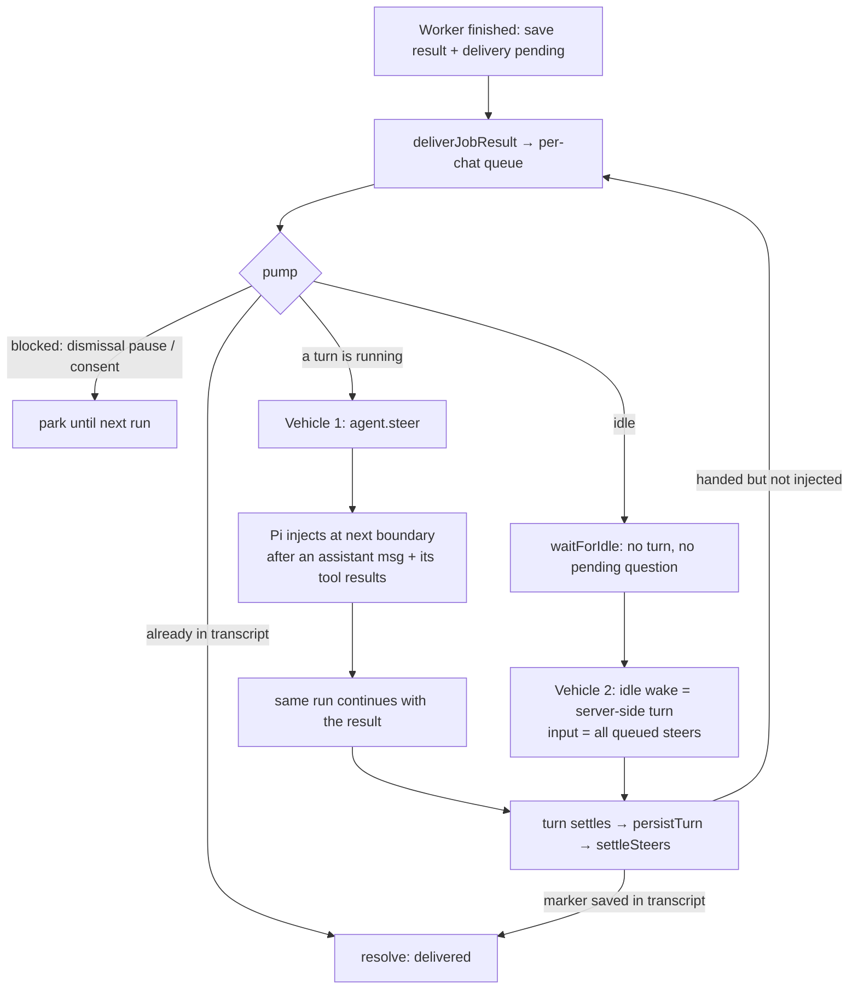

# Subagents and background work

> Status: **first draft**. LearnHarness commit `a636647`. All statements describe **current
> behavior** unless marked.

LearnHarness's subagents are not agents the main agent "talks to". They are **background
workers** with their own isolated Pi loop. The main agent fires one with a tool call, gets an
instant acknowledgement, and keeps teaching. The result comes back later as a **message
injected into the main conversation**, called a *steer*.

LearnHarness's own name for this is **"ack now, steer later"**. It is specified in a long
comment at `src/core/contracts/jobs.ts:152-198` ("THE ASYNC PROTOCOL").

## Kinds of subagents and jobs

| Worker | Started by | Isolated loop | Result | Code |
|---|---|---|---|---|
| **Researcher** | `research` tool | `web_search`, `web_fetch`, PDF tools; knows nothing of the lesson | sourced brief + `sources[]` | `src/agent/subagents/researcher.ts` |
| **PDF reader** | `pdf` tool | reads a local PDF | brief with page citations | `subagents/pdf-reader.ts` |
| **Demo builder** | `demo` tool | writes an HTML demo, tests it headlessly in a browser | `html` + notes | `subagents/demo-builder.ts`, `headless.ts` |
| **Visual maker** | `visual` tool | draws SVG, renders it, inspects it, revises | `svg` (or an annotated image) + notes | `subagents/visual-maker.ts` |
| **Extractor + auditor** | turn settlement / notes import (not a tool) | read prose and propose graph items; audit identities | graph writes | `subagents/extraction.ts`, see [knowledge graph](knowledge-graph.md) |

- The four tool-started kinds are **jobs** (`JobRecord`, `src/core/contracts/jobs.ts:34`). The
  extractor and auditor are a separate pipeline and are not jobs.
- Every subagent runs on the shared helper `subagents/pi-run.ts`, a stateless Pi `Agent` built
  per call and driven to completion. "Submit-style" agents, such as the extractor, produce their
  deliverable as one schema-validated tool call (`subagents/submit-agent.ts`).
- Prober and teacher get `research` and `pdf`; the teacher also gets `demo` and `visual`. These
  four are the only user-toggleable tools (`TOGGLEABLE_TOOLS`, `src/core/pending.ts:87`).

## Launching: the tool call

`jobTools` (`src/agent/tools/jobs.ts:142`) defines `research`, `demo`, `visual`, and `pdf`. Each
`execute` calls `dispatch` (`tools/jobs.ts:83-94`). It:

1. finds an existing job for this `toolCallId`, or creates one (`jobStore.createJob`) with the
   input saved;
2. calls `ctx.spawn(job, input)`, which is `jobRunner.runJob` wired in
   `src/server/chat-handler.ts:766`. The worker starts and nobody waits for it;
3. returns immediately: *"Dispatched (job …). This call is fire-and-forget: continue your turn
   and keep teaching — do not wait, poll, or mention waiting. The … arrives as a new message when
   ready…"* (`tools/jobs.ts:96-107`).

That acknowledgement is the tool call's permanent result. The teacher's turn **does not end**.
It may dispatch more jobs in parallel. Jobs never create a pending state, so the composer is
never blocked by them.

## Running in the background

`createJobRunner` (`src/agent/subagents/runner.ts`) runs the loop for each job kind
(`runJob`, `:194`).

- **Models.** Each kind resolves its own model role fresh per job (`engineFor`, wired at
  `chat-handler.ts:110-131`). With no configured model or a missing key, the job is refused
  cleanly.
- **Progress.** The runner updates `JobRecord.activity` (for example `web_search: "sigma.js v3"`)
  and accumulates `usage`.
- **Browser visibility.** The browser polls `GET /api/jobs?chatId=…`. That one poll drives the
  transcript's dispatch cards and the "background agents" panel.
- **Concurrency.** A process-wide FIFO gate (`src/agent/worker-request-admission.ts`) limits
  concurrent background **model requests**, not whole agents. The limit is
  `agent.workerRequestConcurrency`, default 8 *(per LH docs)*. Teacher, prober, and practice
  requests don't go through this gate.
- **Abort.** `POST /api/activity/abort` → `abortJob` (`src/server/jobs.ts:446`). Only computing
  workers can be aborted. An aborted job still sends an "abort" steer so the teacher learns about
  it.

On completion, `finishJob` (`runner.ts:306-324`):

1. saves `result`, `status` (`done` or `error`), and `delivery: { kind: "result", status: "pending" }`
   in **one** job update;
2. builds the steer (`buildSubagentSteer`, `contracts/jobs.ts:407`) and hands it to
   `deliverJobResult` **without waiting**.

Failures still produce a steer with failure text, so the teacher always learns what happened
(`runner.ts:44-50`).

## The steer message

```ts
{
  id: `steer_${job.id}`,          // deterministic → idempotent delivery
  role: "custom",
  customType: "subagent-steer",
  content: steerText(kind, result), // what the MODEL reads
  display: true,
  details: { jobId, kind, toolCallId, result }, // full payload for the UI card
}
```

`steerText` (`contracts/jobs.ts:372-405`) writes an instruction for each kind, for example:

> *"Research complete — the researcher's full brief follows. Weave it into the lesson and cite
> its sources when you use its findings: …"*

and for failures:

> *"The demo … could not be built: … Fall back to explaining in prose…"*

The model reads the steer as context. The UI renders `details.result` as a card (demo,
figure, or brief).

## How results get back to the main agent

This is `src/server/jobs.ts`, the **wake pipeline**. Its header comment (`:1-57`) is the best
single description. `deliverJobResult` (`:229`) queues the steer in a per-chat registry, and
`pump(chatId)` (`:489`) delivers it by one of **two vehicles**:



### Vehicle 1: live run (Pi steering)

If a turn is running, the steer is handed to the live agent's steering queue (`agent.steer`, via
`handOffEligible`, `jobs.ts:265`). Pi checks that queue **at turn boundaries**: after a completed
assistant message and its tool results, never between a tool call and its result. It then
**continues the same run** with the result in context. The teacher sees the research mid-lesson
and keeps going.

- **A quiz ends the run before Pi's post-turn check**, so a question-terminated run never injects.
  The steer is "stranded", and `settleSteers` (`:401`) returns it to pending.
- **Stranded steers ride the answer turn.** When the learner answers, the handler calls
  `registerLiveAgent` (`jobs.ts:299`) **before** `runPiTurn`
  (`chat-handler.ts:801-810`). Pending steers are handed to the new agent, and they're
  delivered with the **first model call** of the answer turn.

### Vehicle 2: idle wake

With no turn running, `waitForIdle` (`jobs.ts:719`) polls until **no turn is running and no
question is pending**. A grace delay follows. The pump then fires one **server-side turn**
through the normal handler (`setTurnRunner`, `chat-handler.ts:155-161`). Its input is
`{ type: "steers", steers: [all queued markers] }`. That goes through the same path as a browser
request: write-ahead save, liveness, the agent run, and extraction. A **409** (a learner turn
raced in) re-queues with backoff.

### When delivery counts as done

A steer counts as delivered **only when its marker is in the saved transcript**
(`steerDelivered`, `contracts/jobs.ts:488`, which checks for a message with the deterministic id).
An HTTP 200 or a visible stream event doesn't count. `noteSteersDurable` and `settleSteers`
reconcile the registry against what was actually saved.

### What blocks delivery

- a pending question (`hasUnresolvedQuestion`);
- a dismissal pause (see [question tools](question-tools.md#dismissal-esc));
- subscription background consent turned off (`automaticFollowUpAllowed`, `jobs.ts:259`;
  `connectionBackgroundAllowed`, `chat-handler.ts:102`).

### Crash recovery

`recoverStaleJobs` (`jobs.ts:758`) is a throttled sweep, every 30 s at most, triggered by the
`/api/jobs` poll.

- A job whose delivery is pending is re-queued.
- A `running` job with no live worker in this process is **respawned**.
- Legacy terminal jobs without delivery metadata are left alone.
- Deleting a session discards its pending deliveries (`discardChatDeliveries`, `:211`).

## The probe → teacher handoff (a special steer)

`probe_done` (`src/agent/tools/probe.ts:49`) is how the prober ends its phase. Its arguments
**are** the learner assessment: per dependency strand, the floor, ceiling, and misconceptions.

1. It's refused if a question is still pending or the probe already concluded.
2. It queues `buildProbeHandoffSteer(chatId)`, which has `customType: "probe-handoff"` and
   id `steer_probe_<chatId>` (`contracts/jobs.ts:481`).
3. It returns a fixed acknowledgement.

The handoff steer **never** uses vehicle 1 (`jobs.ts:530-541`). It must start a **fresh** run,
because the next agent is built from the transcript. Once `probe_done` is saved,
`hasProbeDone` is true and the handler builds the **teacher**. The idle wake therefore starts the
teacher's first (planning) turn automatically. If queuing fails, the learner's next message still
gets the teacher, because the transcript is the deciding signal.

## Learner messages during a running turn (composer steers)

Learner messages sent while a turn runs use the same steering mechanism.
`POST /api/chats/:id/steer` (`app/api/chats/[id]/steer/route.ts`) → `prepareAndSteerChat`
(`jobs.ts:320`) hands the message to the live agent's steering queue. It's injected at the next
boundary of the **same run** and saved by that run's settlement. With no live turn, the route
returns 409 and the browser falls back to a normal send. Stranded composer steers carry over to
the next run (`reconcileUserSteers`, `:357`).

LearnHarness's docs note that these in-memory composer steers aren't as durable as job delivery
*(per LH docs)*.

## Port notes

Outcomes are recorded in [decisions](../decisions.md) and [architecture](../architecture.md).

- **The core idea is simple and kept:**
  1. a tool starts a worker and acknowledges instantly;
  2. the worker saves its result plus a "delivery pending" flag;
  3. a per-session queue delivers the result as a message, either into the running agent at a
     safe boundary or by starting a new turn when idle;
  4. delivery is confirmed by the marker being in the saved transcript.
- **Most of LearnHarness's complexity here comes from three things:**
  - Pi's steering semantics: boundaries, the stopper running before the poll, and stranding;
  - subscription consent and admission;
  - all state being module-global `globalThis` maps that are coordinated by polling
    (`waitForIdle` with `POLL_MS`/`GRACE_MS`).
- **Decided: event-driven delivery.** The session's `SessionRuntime` owns the queue, and asyncio
  events ("turn ended", "result ready") wake delivery. No polling loops, no TTL leak guards.
- **Workers are asyncio tasks** in the Python sidecar, each running its own Pydantic AI agent, with a
  SQLite `jobs` table. Recovery runs when the UI polls for jobs, as in LearnHarness.
- **Mid-run injection** (the teacher weaves research in mid-lesson) uses Pydantic AI's
  `before_model_request` hook. The spike confirmed that injected messages are saved exactly once.
- **Decided: one delivery step, three named kinds.** Job results, the probe handoff, and composer
  steers (plus side-chat updates) all go through one "context update before the next model call"
  step, but each is its own named kind. **The probe handoff is written as an explicit phase
  transition**, not a special-cased steer. The saved entries stay the same as in LearnHarness.
