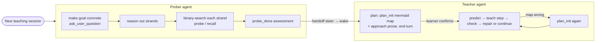

# Teaching flow

> Status: **first draft**. LearnHarness commit `a636647`. All statements describe **current
> behavior** unless marked.
>
> The pedagogy itself is in LearnHarness `docs/teaching-methodology.md` (10 sections, from "Two
> knowledge states" to "What this demands of the implementation"). This doc covers **how the
> software and prompts implement it**.

## The arc

The phase is **derived from the transcript, never stored** (`src/core/phases.ts:1-13`,
`phaseAt3`, `:50`):

- **probe**: until `probe_done` has a successful result.
- **plan**: after that, until the first **node-tagged** `quiz` or `explain` call.
- **teach**: from that call onward.

Which **agent** runs is decided by a simpler check, `hasProbeDone` (see [overview](overview.md)):
prober before `probe_done`, teacher after. The teacher handles both "plan" and "teach".

## Prompt composition

Prompts are Markdown fragments under `src/agent/prompts/`, composed per turn by
`composeInstructions` (`src/agent/teacher-agent.ts:87`). The rules are in
`src/agent/prompts/README.md`.

| Agent | Composition |
|---|---|
| Prober | `system-prompt.md` → `prober/*` → `shared/*` |
| Teacher | `system-prompt.md` → `teacher/*` → `shared/*` |
| Practice | `practice/*` → an allowlisted subset of `shared/*` (no teaching base) |
| Side helper | `side-chat/00-base.md` → shared voice/accuracy/formatting → `side-chat/90-style.md` |

- **Ordering.** Fragments are sorted by filename (`NN-name.md`) and joined with `\n\n---\n\n`.
- **Overrides.** Each segment can be overridden by a user file in `data/prompts/<same path>`. An
  override only applies when its switch `settings.agent.prompts[path]` is on.
- **Size.** About 500 lines of Markdown in total.

| Fragment | Content |
|---|---|
| `system-prompt.md` | Purpose ("install understanding"), and why teaching must work at the learner's edge |
| `prober/10-probe-doctrine.md` | The probe procedure (below) |
| `teacher/05-method.md` | **Principle i** (unconditional truths first) and **Principle ii** ("how could I have discovered this?") |
| `teacher/10-planning.md` | Planning, the plan map, rewriting it, presenting it |
| `teacher/20-teaching.md` | One step at a time; Socratic vs expository; checks after the prose |
| `teacher/28-predictions.md` | The predict → teach → check cycle |
| `teacher/30-question-principles.md` | What a check must be |
| `teacher/40-jobs.md`, `50-demos.md`, `55-images.md` | When to use research/PDF, demos, figures |
| `shared/10-voice`, `15-accuracy`, `16-mental-model`, `20-question-tools`, `25-confidence`, `30-learner-files`, `35-side-conversations`, `40-formatting` | Cross-agent rules: voice, reading the thinking fields and confidence, tool use, formatting |

## Probing

The doctrine is in `src/agent/prompts/prober/10-probe-doctrine.md`. The prober makes two
measurements:

- **what he needs to learn**, his goal, using `ask_user_question`;
- **what he already knows**, a precise map, using `probe` or `recall`.

The steps:

1. **Read the persistent map.** `list_sessions` and `list_propositions` (graph readers, only when
   graph tools are enabled) show what earlier sessions established.
2. **Make the goal concrete.** Keep asking until "I want to understand LLMs" becomes something
   specific.
3. **Reason out the strands**, the dependencies the lesson will rest on.
4. **Binary-search each strand.** Find a *floor* (reliably right) and a *ceiling* (wrong or
   unknown):
   - Enter near the top, not the bottom.
   - Correct and confident → jump up sharply.
   - Correct but hesitant → step up gently.
   - Wrong → narrow back down.
   - Dig into misconceptions.
   - Every question must move an edge.
5. **Conclude with `probe_done`.** Its input (`src/core/contracts/probe.ts:47`) is
   `{ assessment: { strands: [{ strand, assessment }], summary? } }`, where each assessment
   covers the floor, ceiling, misconceptions, and what to build from. The call is refused while a
   question is pending, or if the probe has already concluded. It queues the **handoff**; see
   [subagents](subagents-and-background-work.md#the-probe--teacher-handoff-a-special-steer).

The handoff wake adds a marker whose model-facing text is `HANDOFF_TEXT`
(`src/core/contracts/chat.ts:230`): *"Next: plan the full teaching arc from my current
understanding to the goal understanding. Apply the teaching methodology… Take your time here…"*.
The teacher's first turn is therefore planning.

## Planning

The doctrine is in `teacher/10-planning.md`.

- **The plan.** Reason out the field (dispatching research where unsure), the unconditional
  truths, what he already holds, and the motivated path to the goal. The result is the
  **minimal tree**: nothing re-taught, nothing off-path.
- **The map: `plan_init`** (`src/agent/tools/plan.ts:62`) takes a Mermaid `graph` block:
  - nodes are written `slug[Short Title]`, where slugs are permanent lowercase ids;
  - `-->` means *"from must be understood before to"*.

  `parseMermaidPlan` (`tools/mermaid-plan.ts:77`) parses it. `createTree`
  (`core/plan-tree.ts:112`) validates it (no duplicate ids, no missing endpoints, no self-loops,
  no cycles) and saves `ChatRecord.tree` (`PlanTree`: `nodes`, `edges`, `version`;
  `core/contracts/plan.ts:29`). The result returns only the node ids and a reminder, while
  `details` carries the full tree for the UI. Calling it again **replaces** the map.
- **Presenting.** The teacher writes a few sentences on the approach, and the map appears as a
  live diagram. The teacher must not redraw it in prose. **Presenting ends the turn.** The
  learner confirms or asks for changes. *This confirmation is prompt doctrine only; no state
  records that the plan was accepted.*
- **Plan blocks.** `persistTurn` appends a `plan-block` marker after a successful `plan_init`
  (`planBlocksFor`, `core/plan-blocks.ts:75`). It's a frozen snapshot of the map, shown inline in
  the chat. It's UI-only; `toLlmMessages` skips it.

### Position on the map

Position on the map is **derived from question calls, never from results**
(`derivePlanStatuses`, `core/contracts/plan.ts:45-90`):

- **current** is the node of the most recent `nodeId`-tagged quiz or explain call;
- **visited** is every node tagged earlier;
- everything else is **upcoming**.

There's no "done" ledger. Moving to the next node is the teacher's judgment that the previous one
is finished. Node ids that a rewrite removed are ignored.

## Teaching steps

The doctrine is in `teacher/20-teaching.md`, `28-predictions.md`, and `30-question-principles.md`.

Each step works like this:

1. **One step, one fact.** It's small enough to land at once, presented in its clearest form
   (asserted, narrated, or drawn out Socratically).
2. **The cycle: predict → teach → check.**
   - **Predict** (`type: "predict"`) is posed **before** teaching the step, as its own turn. It
     nudges him to discover the next step, and need not be answerable yet. It arrives **open**.
   - **Teach.** The next turn opens by explicitly resolving his prediction, then teaches the step.
   - **Check** (`type: "check"`) is posed **after** the step's prose is complete. It must be
     answerable by reasoning from the session, applied rather than recited, and designed so a
     wrong option names a specific wrong model. It arrives **collapsed** behind "Check your
     understanding".
   - **React.** A miss means diagnose and repair before building further.
3. **One question per turn, every turn.** This is enforced structurally: a question ends the run.
4. **Socratic vs expository** is chosen per step, depending on the topic and the learner's energy.
5. **Reading the learner.** The thinking fields are "the session's primary data"
   (`shared/16-mental-model.md`). Confidence is read against the verdict, and *wrong + high
   confidence* is "the strongest signal you can receive" (`shared/25-confidence.md`).
6. **The map moves with him.** Re-call `plan_init` whenever teaching shows the map is wrong.
   Repairs are taught one step at a time too, never as a wall of text.

The teacher can also dispatch **research**, **pdf**, **demo**, and **visual** jobs, and use
`show_image` and the read-only file tools (`read`, `ls`, `find`, `grep`). For Claude-family models
there's also `send_to_user`.

## Practice sessions

A separate session kind (`kind: "practice"`) has its own agent, the practitioner, and its own
prompt (`prompts/practice/`, with sections such as *The three modes*, *Posing a demand*, *Hints*,
*Claimed answers*, *Progression*):

- `problem` commits a statement and its solution, then poses it. This ends the turn.
- `conclude` records the outcome and reveals the solution.
- One problem can be active at a time (`createPracticeGate`, `src/agent/tools/practice.ts`).
- Practice targets graph propositions. Its outcomes are session evidence, not graph mastery, and
  **practice sessions never trigger extraction** (`chat-handler.ts:887`).

## Port notes

Outcomes are recorded in [decisions](../decisions.md).

- **The pedagogy lives almost entirely in prompts and tool contracts.** The code enforces only:
  - one question per turn (the stop rule);
  - a required `nodeId` and `type` on teach questions;
  - a valid acyclic map;
  - `probe_done` being refused while a question is pending.

  Everything else (binary search, predict/check, unconditional truths) is doctrine. **The prompt
  fragments move over verbatim**, along with the composition order and the override mechanism.
- **The phase is derived, which is good:** one source of truth. Kept.
- **Inconsistency resolved.** The `plan_init` tool description says *"5–15 nodes … compress"*
  (`tools/plan.ts:67-72`), but `teacher/10-planning.md` says *"No size ceiling … elaborate is
  fine"*. **Decided:** 5–15 nodes; the planning prompt is changed to match.
- **Plan acceptance** is conversational only. An explicit "plan accepted" state would be a behavior
  change, which the faithful-port rule excludes.
- **Practice sessions are in scope** (decided).
