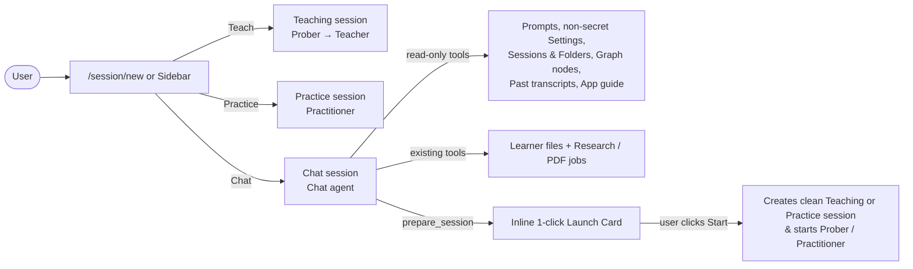

# General Chat Agent (`kind = "chat"`)

> Status: **approved by the user (2026-11-26).** Ready for implementation on Pixal in a new branch
> off `dev`. This feature has no LearnHarness counterpart.

## Overview

Add a third session kind, **Chat** (`kind = "chat"`), alongside **Teaching** (`teach`: Prober →
Teacher) and **Practice** (`practice`: Practitioner). A Chat session runs a dedicated general chat
agent that can hold freeform conversations, explain how Verstehen works and where settings live,
inspect live prompts, non-secret settings, knowledge-graph nodes and chains, sessions, folders, and
past transcripts, and prepare a **1-click Launch Card** that creates and starts a clean Teaching
(Prober) or Practice (Practitioner) session when the user clicks it.



- **What changes:**
  - **Storage, sync & roles:** SQLite migration `0011_chat_sessions.sql` widens `sessions.kind` to
    `('teach', 'practice', 'chat')` using the FK-safe rebuild pattern from `0010`. Update
    `SessionKind`, sync payload validation (`store/sync.py`), `ModelRole` (`"chat": "strong"`),
    compaction `TurnRole`, and `TURN_ROLES` in session stats.
  - **Chat agent, prompts & bundled guide:** Add `backend/src/verstehen/teaching/chat/` (`agent.py`,
    `tools.py`, `schemas.py`, `transcript.py`) and `backend/src/verstehen/teaching/prompts/chat/`
    (`00-base.md`, `10-tools.md`, plus bundled `guide.md`). Expose `chat` prompt segments in
    `PromptOverridesService` and **Settings → Prompts**. Register all new tool names in
    `plugins/reserved.py` and `app/src/lib/teaching/built-in-tools.ts`, and verify `chat/` prompts
    and `guide.md` in `self_check.py`.
  - **Turns & graph exclusions:** Wire `role == "chat"` into `TurnService` with the read-only
    inspection tools, `prepare_session`, learner-file tools (`read`, `ls`, `find`, `grep`), and
    `research` / `pdf` background jobs. Generalize existing `kind == "practice"` exclusions to
    `kind != "teach"` across `ExtractionService`, `SessionService` coverage, `chain-table-model.ts`,
    and `DeleteSessionDialog`.
  - **Frontend UI:** Add **Chat** to the sidebar header, 4-way sidebar filter
    (`Teaching | Practice | Chat | All`), folder context menus (**New chat here**), `/session/new`
    (`Teach | Practice | Chat` toggle, `?mode=chat`), **Settings → Prompts**, thread header badge
    (speech-bubble icon, no phase chip or coverage ring), and inline `PrepareSessionCard` for
    `prepare_session` tool calls.
- **What the user notices:**
  - Start a **Chat** session from the sidebar, `/session/new`, or a folder's context menu. It uses
    the **Main** (`strong`) model by default with the normal composer model picker, Jobs tab, Side
    chat, compaction, and Stats bar.
  - Ask about Verstehen's features, where to change settings, what is inside any agent's prompt
    (defaults and overrides), what nodes/chains exist in the knowledge graph, what sessions/folders
    exist, or what happened in a past session.
  - Ask to start a lesson or practice session: the agent renders an inline **Launch Card** showing
    the prepared kind, title, opening prompt, target folder, and picked graph nodes. Clicking
    **Start teaching →** (or **Start practice →**) creates the session, starts the Prober (or
    Practitioner) immediately, and navigates into it.
  - Customize the Chat agent's own prompt segments under **Settings → Prompts**.
- **Non-obvious effects:**
  - **Migration `0011` and sync:** Bumps the SQLite schema version; laptop ↔ server sync pauses
    cleanly (`update_required`) until both backends update to the same build, after which Chat
    sessions sync across laptop, server, and Android like Teaching and Practice sessions.
  - **Knowledge graph stays clean:** Chat sessions never trigger extraction, have `coverage = None`,
    are refused by `POST /api/graph/coverage/extract` (400), are omitted from the Chains table, and
    delete without graph-trace options.
  - **Strict no-secrets boundary:** `read_settings` exposes only non-secret settings and safe
    status metadata (account names/kinds/usability, whether Brave/Tavily search keys are configured)
    — never API keys, OAuth tokens, Claude Code credentials, or sync/SSH secrets.
  - **App guide packaging & upkeep:** Storing the bundled reference at
    `teaching/prompts/chat/guide.md` (unnumbered filename) means PyInstaller's existing
    `teaching/prompts/**/*.md` glob collects it automatically while `FRAGMENT_RE` ignores it for
    prompt composition; `verstehen --self-check` verifies it is present. Keep `guide.md` updated
    alongside `docs/feature-map.md` when future features change.
  - **Plugins:** Plugins continue to target `prober`, `teacher`, and `practice` only (no plugin API
    change); Chat sessions pass `topBarSurface = undefined` in `+layout.svelte`, and all new Chat
    tool names are added to `plugins/reserved.py` and `built-in-tools.ts`.

---

## Locked-in user decisions

Every decision below was explicitly approved by the user on 2026-11-26:

1. **Architecture & probe handoff:** Add a 3rd session kind (`kind = "chat"`) alongside `teach` and
   `practice`. Teaching sessions still start directly with the **Prober** (exact LearnHarness flow,
   zero extra turns or context pollution). The Chat agent launches a **brand-new, clean** Teaching
   (or Practice) session rather than transitioning in-place.
2. **Permissions:** Read-only inspection + launching new sessions. The Chat agent does **not** edit
   settings, prompt overrides, or folders directly — it tells the user what is set and where to
   change it.
3. **Launch UX (1-click Launch Card):** `prepare_session` does **not** create a session or run a
   Prober turn during the Chat turn. It renders an inline card with a **Start teaching →** /
   **Start practice →** button. Clicking creates the session, fires the Prober/Practitioner opening
   turn, and navigates straight into it (zero accidental sessions or wasted subscription quota).
4. **Tool scope:** Core Verstehen inspection & launch tools (`list_prompts`, `read_prompt`,
   `read_settings`, `list_sessions_and_folders`, `list_graph_nodes`, `read_graph_node`,
   `read_session`, `read_app_guide`, `prepare_session`) **plus** existing learner-file tools
   (`read`, `ls`, `find`, `grep` under File access) and `research` / `pdf` background jobs (under
   Settings → Tools and background consent). No question/quiz dock (`probe`/`quiz`/`ask_user_question`),
   no `demo`/`visual` jobs, no `show_image`, no `send_to_user`.
5. **Naming & UI:** Named **Chat** (`kind = "chat"`, `MessageSquare` icon) across the sidebar
   header, 4-way sidebar filter (`Teaching | Practice | Chat | All`), folder context menu (**New
   chat here**), `/session/new` toggle (`Teach | Practice | Chat`), thread header badge, and
   **Settings → Prompts**.
6. **Default model slot:** Main (`strong`) slot, overridable per session via the composer model
   picker (same as Teaching and Practice).

---

## Architecture & layer rules

The backend layer order in `backend/pyproject.toml` stays unchanged:

```
desktop  →  api | lh_import  →  sync  →  session  →  jobs | sidechat | graph | plugins  →  teaching | providers  →  store
```

- `teaching/chat/` sits inside `teaching/` and knows nothing about HTTP, SQLite, or `sync/`. It
  receives pure async reader callbacks from `session/turns.py` (following `prober_graph_tools` and
  `job_tools`).
- **Prompt reading (`list_prompts`, `read_prompt`)** needs no `sync/` import: `session/turns.py`
  already has `settings_store`, `data_dir`, and `prompt_edit_lock`, and `teaching/prompts.py`
  already owns `segment_keys`, `source_text`, `read_override`, and symlink checks.
- **Safe settings & account/search-key status (`read_settings`):** Pass a lightweight read-only
  status callback from `app.py` into `TurnService` (reading non-secret `Account` labels/kinds/
  usability from `accounts_service` and boolean `SearchKeysStatus` from `search_keys_service`,
  never touching `credentials_store` directly).
- **`prepare_session` streaming:** Add `"prepare_session"` to `STREAMED_RESULT_TOOLS` in
  `session/turns.py` so its validated `ToolResultEntry.details` streams live to `responseProse` and
  persists for reload.

---

## Tool contracts & safety rules

All new tool names must be added to both `backend/src/verstehen/plugins/reserved.py` and
`app/src/lib/teaching/built-in-tools.ts`:

| Tool | Arguments | Behavior & safety rules |
|---|---|---|
| `list_prompts` | *(none)* | Lists every prompt segment across `teacher`, `prober`, `practice`, `chat`, `shared`, and `side-chat` under `prompt_edit_lock`, showing `path`, which agent(s) use it, whether an override file exists, and whether the override is currently active. Notes that `side-chat/` is file/switch-overridable even though Settings → Prompts lists `Teacher`, `Prober`, `Practice`, `Chat`, and `Shared`. |
| `read_prompt` | `path: str` | Validates `path` against the known segment set (rejecting unknown paths and traversal; symlink-safe via `read_override`). Returns the shipped default text, the saved override text (if any), and which version is active. |
| `read_settings` | *(none)* | Returns current non-secret `Settings` (`models`, `quizzing`, `compaction_limit`, `tools`, `search_engine`, `graph`, `agent`, `background`, `file_access`, `worker_request_concurrency`, `demo_browser`, plus `file_access_error` if unreadable), plus safe account status (`id`/`label`/`kind`/`usable`, no tokens) and search-key configured booleans (`tavily: bool`, `brave: bool`, no key values). |
| `list_sessions_and_folders` | `kind?: "teach" \| "practice" \| "chat"`, `folder_id?: str` | Reads `sessions_store.list()` and `graph_store.read().organization` and returns the folder hierarchy (id, name, parent_id) and sessions (id, title, kind, folder_id/path, created_at, updated_at, model). |
| `list_graph_nodes` | `query?: str`, `session_id?: str`, `folder_id?: str`, `limit?: int` (default 50, max 100), `offset?: int` (default 0) | Reads `get_graph(ledger)` and filters nodes by case-insensitive substring match across `name`/`statement`/`aliases`, birth/provenance `session_id`, or folder subtree (`folder_id`). Returns total count, pagination info, and compact rows (`id`, `name`, short statement preview, birth session title/path). |
| `read_graph_node` | `node_id: str` | Returns full proposition `id`, `name`, `statement`, `aliases`, `created_at`, resolved `provenance` (session title / kind or imported note file path), and connected `chains` (premises and conclusions with names). |
| `read_session` | `session_id: str`, `offset?: int` (default 0), `limit?: int` (default 30, max 50) | Reads `entries_store.list(session_id)` and formats readable conversation items (user text, assistant prose / `send_to_user` text, question prompts & answers, practice problems / thinking / conclusions, plan titles, compaction markers), omitting raw base64/binary blobs and internal noise. Caps response size (~24,000 chars) with clear `next_offset` / `total` pagination hints. |
| `read_app_guide` | `section?: str` | Without `section`, lists available sections of `teaching/prompts/chat/guide.md`. With `section`, returns that section's markdown (covering features, session kinds, right panel, graph, plugins, sync/mobile, and every Settings section: Appearance, Models, Accounts, Lesson, Prompts, Graph, Tools, Plugins, Sync/Connection). |
| `prepare_session` | `kind: "teach" \| "practice" = "teach"`, `opening_prompt: str`, `title?: str`, `folder_id?: str`, `proposition_ids?: list[str]` | Pure validation tool (writes nothing). Validates `opening_prompt` is non-empty, validates `folder_id` against current folders (resolving `folder_name`), validates `proposition_ids` against live graph nodes (resolving `{id, name}` pairs). Returns `ToolReturn` with structured `metadata` (`kind`, `title`, `opening_prompt`, `folder_id`, `folder_name`, `propositions`) rendered by `PrepareSessionCard`. Invalid folder/node IDs return a clear error so the model can correct them. |

---

## Tasks

### Backend — T1 (Migration, store, sync & roles)

1. **FK-safe migration (`backend/src/verstehen/store/migrations/0011_chat_sessions.sql`):**
   - Leading `-- foreign_keys: off` (same pattern as `0010_practice_sessions.sql`).
   - Rebuild `sessions` with `kind TEXT NOT NULL CHECK (kind IN ('teach', 'practice', 'chat'))`,
     copy all rows, drop old table, rename, and recreate trigger `delete_session_usage`.
   - Run `make lock-migrations` (or update migration hash check per `tools/check_migrations.py`).
2. **Store & sync (`store/sessions.py`, `store/sync.py`):**
   - `SessionKind = Literal["teach", "practice", "chat"]`.
   - Update `_SessionUpsertPayload.kind` in `store/sync.py` to `Literal["teach", "practice", "chat"] = "teach"`.
3. **Roles, compaction & stats (`providers/resolve.py`, `session/compactions.py`, `session/stats.py`):**
   - Add `"chat"` to `ModelRole` and `"chat": "strong"` to `ROLE_SLOT`.
   - Widen `TurnRole = Literal["teacher", "prober", "practice", "chat"]` in `session/compactions.py`.
   - Add `"chat"` to `TURN_ROLES` in `session/stats.py`.

### Backend — T2 (Chat agent, prompts, guide & tools)

1. **Prompts & guide (`teaching/prompts.py`, `teaching/prompts/chat/`):**
   - Widen `PromptKind = Literal["prober", "teacher", "practice", "chat"]` and `PROMPT_KINDS`.
   - Add `CHAT_SHARED_FRAGMENTS = ("10-voice.md", "15-accuracy.md", "30-learner-files.md", "35-side-conversations.md", "40-formatting.md")`.
   - In `segment_keys(kind)`: omit `system-prompt.md` for `"chat"` (just like `"practice"`), include
     sorted numbered `chat/*.md` fragments plus `CHAT_SHARED_FRAGMENTS`.
   - Add helper `side_chat_segment_keys()` (or include `side-chat/*.md` in a read-only listing helper
     used by `list_prompts` / `read_prompt`).
   - Write:
     - `teaching/prompts/chat/00-base.md`: role (general conversation + Verstehen expert), tone,
       read-only stance (never claim to have changed a setting/prompt/folder; point to the exact
       Settings path), and when to use `prepare_session` (only when the user asks or agrees to start
       a Teaching probe or Practice session).
     - `teaching/prompts/chat/10-tools.md`: guidance for each inspection tool, pagination on
       `list_graph_nodes` / `read_session`, and grounding answers in live tool reads rather than
       guessing settings or prompt contents.
     - `teaching/prompts/chat/guide.md`: concise, structured section-indexed reference of Verstehen's
       features, UI surfaces, keyboard shortcuts, session kinds, right panel, knowledge graph,
       plugins, sync/mobile, and all Settings sections.
2. **Chat agent package (`backend/src/verstehen/teaching/chat/`):**
   - `schemas.py`: Pydantic models for tool outputs & `PrepareSessionPayload` (`kind`, `title`,
     `opening_prompt`, `folder_id`, `folder_name`, `propositions`).
   - `transcript.py`: `format_session_transcript(entries, offset, limit, max_chars)` producing clean
     paginated excerpts of past sessions.
   - `tools.py`: `chat_tools(...)` building the 9 read-only + `prepare_session` `Tool[None]`
     definitions from injected async readers (no SQLite/HTTP imports).
   - `agent.py`: `build_chat(model, instructions, settings, *, extra_tools, extra_capabilities)`
     returning a `QuestionAgent`-compatible `Agent` (no `send_to_user`, no deferred question tools,
     using `ConversationToolErrors` for truncated-output protection like `build_practitioner`).
3. **Prompt overrides, self-check & reserved tools:**
   - `sync/prompt_overrides.py`: add `chat: list[PromptSegment]` to `PromptSegments` and include
     `chat=agent("chat")` in `_read_segments`.
   - `self_check.py`: add `"chat"` to `check_prompts()` and assert
     `(PROMPTS_DIR / "chat" / "guide.md").is_file()`.
   - `plugins/reserved.py`: add all 9 new tool names (`list_prompts`, `read_prompt`,
     `read_settings`, `list_sessions_and_folders`, `list_graph_nodes`, `read_graph_node`,
     `read_session`, `read_app_guide`, `prepare_session`) and update
     `backend/tests/plugins/test_agent_hooks.py` to also assert `build_chat`'s tools are in
     `RESERVED_TOOL_NAMES`.

### Backend — T3 (TurnService, SessionService, ExtractionService & app wiring)

1. **`session/turns.py` & `app.py`:**
   - Widen `TurnState.role` to `Literal["teacher", "prober", "practice", "chat"]`: return `"chat"`
     when `self.session_kind == "chat"`.
   - Add `"prepare_session"` to `STREAMED_RESULT_TOOLS`.
   - Inject safe read-only `accounts_status` and `search_keys_status` callables from `app.py` into
     `TurnService` (no secret values).
   - In `build_role_agent`: handle `role == "chat"` by calling `build_chat(...)` with
     `*chat_tools(...)`, `*files`, and `*job_tools(dispatcher, settings.tools, prober=True)` (which
     arms `research` and `pdf` respecting `settings.tools` and background consent), plus
     `extra_capabilities=(updates,)`. Do **not** call `plugin_service.toolset_for` for `"chat"`.
   - In `settle`: `extraction_service.trigger` already skips `session.kind != "teach"`; verify
     `handoff_owed` never fires for `chat`.
2. **Non-teach exclusions (`session/sessions.py`, `graph/extraction_service.py`):**
   - `session/sessions.py`: change `session.kind == "practice"` to `session.kind != "teach"` in
     `get()` and `coverage()` so Chat sessions always report `coverage = None`.
   - `graph/extraction_service.py`: change `if session.kind == "practice":` (line 221) to
     `if session.kind != "teach":` with a clear 400 error (`"Only teaching sessions run graph extraction"`
     or kind-specific message).

### Frontend — F1 (API types, sidebar, `/session/new`, graph exclusions & Settings → Prompts)

1. **Regenerate OpenAPI types:** run `make api-types` (`app/src/lib/api/schema.ts` picks up
   `kind: 'teach' | 'practice' | 'chat'` and `PromptSegments.chat`).
2. **Sidebar & `/session/new`:**
   - `app/src/routes/(lesson)/+layout.svelte`: add **Chat** button (`MessageSquare` icon,
     `/session/new?mode=chat`) alongside **Teaching** and **Practice**; update `topBarSurface` so
     `watched.record.kind === 'chat'` yields `undefined` (plugins target `teaching | practice` only).
   - `app/src/lib/session/session-list-model.ts`: widen `KindFilter` to
     `'teach' | 'practice' | 'chat' | 'all'` and add `{ value: 'chat', label: 'Chat' }` to
     `kindFilters`.
   - `app/src/lib/components/session-list.svelte`: show a subtle `MessageSquare` icon on
     `session.kind === 'chat'` rows; wire `onnewsession` for `'teach' | 'practice' | 'chat'`.
   - `app/src/lib/components/sidebar-folder-row.svelte`: add **New chat here** context-menu item.
   - `app/src/lib/components/new-session-query.ts` & `new-session.svelte`: support `'chat'` mode
     (`?mode=chat`), 3-way `Teach | Practice | Chat` toggle, tailored subtitle & composer
     placeholder (*"Ask about Verstehen, your notes, or anything else…"*), and hide/keep `NodePicker`
     consistent (optional: hide `NodePicker` in `chat` mode or allow it; simplest is hiding
     `NodePicker` on `chat` since Chat has live graph search tools).
3. **Graph & delete exclusions:**
   - `app/src/lib/graph/chain-table-model.ts`: exclude all non-`teach` session sources
     (`source.session_kind && source.session_kind !== 'teach'`).
   - `app/src/lib/graph/delete-session-dialog.svelte`: change `session.kind === 'practice'` to
     `session.kind !== 'teach'` so Chat sessions hide the graph-traces checkbox and send
     `mode=preserve-graph`.
4. **Settings → Prompts & built-in tools:**
   - `app/src/lib/prompts/segments.ts` & `app/src/lib/components/settings-prompts.svelte`: add
     `{ id: 'chat', label: 'Chat' }` to `agents` and `showSwitch`.
   - `app/src/lib/teaching/built-in-tools.ts`: add all 9 new Chat tool names to `BUILT_IN_TOOLS`.

### Frontend — F2 (Chat thread header & 1-click `PrepareSessionCard`)

1. **Controller & thread header (`controller.svelte.ts`, `session-thread.svelte`):**
   - Add `isChat = $derived(this.record?.kind === 'chat')` on `SessionController`.
   - In `session-thread.svelte`:
     - Header badge: 3-way branch (`isPractice` → Practice badge, `isChat` → `<MessageSquare /> Chat`
       badge with no `CoverageRing`, else `teach` → `phaseLabel[phase]` + `CoverageRing`).
     - Suppress phase dividers when `controller.isPractice || controller.isChat`.
     - Enable `autoScroll` when `controller.isChat`.
2. **Inline Launch Card (`app/src/lib/chat/prepare-session-card.svelte`, `response-prose.ts`, `session-thread.svelte`):**
   - In `response-prose.ts`: recognize `part.tool_name === 'prepare_session'` (when `result` is
     present and not `is_error`) and emit `{ kind: 'prepared-session', result }`.
   - Build `PrepareSessionCard.svelte`:
     - Displays target kind badge (**Teaching** or **Practice**), title (if provided), folder chip
       (if provided), picked graph node chips (if provided), and a clean preview of the prepared
       `opening_prompt`.
     - Clicking **Start teaching →** (or **Start practice →**) runs the same flow as
       `new-session.svelte`: checks model slots (`SetupDialog` if incomplete), calls
       `createSession(title || opening_prompt, null, graphContext, kind, folderId)` (gracefully
       falling back to top-level with an inline note if `folderId` was deleted meanwhile), calls
       `stashOpening(created.id, opening_prompt)`, and calls
       `goto(resolve('/(lesson)/session/[id]', { id: created.id }))`.
     - Shows inline error if creation fails; prevents double-clicks while creating.

---

## Tests, verify flows & feature-map entries

- **Backend tests (`make check AREA='store sync teaching session graph plugins shell'`):**
  - `backend/tests/store/test_store.py`: migration `0011_chat_sessions.sql` widens `kind`, preserves
    existing rows, keeps `delete_session_usage` trigger.
  - `backend/tests/sync/test_sync.py`: `kind = "chat"` session upserts push and pull cleanly.
  - `backend/tests/teaching/test_chat.py`: prompt composition for `chat`, `list_prompts` /
    `read_prompt` (defaults, overrides, switches, symlink/path rejection), `read_settings` (full
    non-secret fields + strict assertion that API keys / OAuth tokens / credentials never appear),
    `list_sessions_and_folders`, `list_graph_nodes` / `read_graph_node` (query/session/folder
    filters, chains, provenance), `read_session` (pagination & char cap), `read_app_guide`
    (index & sections), `prepare_session` (valid teach/practice + invalid folder/node errors),
    and end-to-end `FunctionModel` turn with tool calls.
  - `backend/tests/teaching/test_prompt_overrides.py`: `GET /api/prompts` includes `chat`, override
    save/enable/delete reaches composed `chat` prompt.
  - `backend/tests/graph/test_extraction_api.py`: `POST /api/graph/coverage/extract` refuses a
    `chat` session with 400; `GET /api/sessions/{id}/coverage` returns `null`.
  - `backend/tests/session/test_stats.py`: `chat` usage rows count as turns.
  - `backend/tests/plugins/test_agent_hooks.py`: all `build_chat` tools are in `RESERVED_TOOL_NAMES`;
    plugins do not hook `chat` turns.
  - `backend/tests/shell/test_self_check.py`: `check_prompts` verifies `chat/` fragments and
    `guide.md`.
- **Frontend Vitest tests (add `src/lib/chat/*.test.ts` to `VITEST_GLOBS["teaching"]` in `tools/test_areas.py`):**
  - `app/src/lib/chat/prepare-session-card.svelte.test.ts`: renders teach/practice card metadata,
    clicks Start → creates session with folder & graph context, stashes opening prompt, navigates;
    handles deleted folder fallback and API errors.
  - `app/src/lib/session/session-list-model.svelte.test.ts`: 4-way `KindFilter` (`teach`, `practice`,
    `chat`, `all`).
  - `app/src/lib/prompts/segments.test.ts` & `settings-prompts.svelte.test.ts`: `Chat` section.
  - `app/src/lib/graph/chain-table-model.test.ts` & `delete-dialogs.svelte.test.ts`: `chat` excluded
    from Chains table and delete graph-traces.
  - `app/src/lib/teaching/teaching.test.ts`: `responseProse` emits `prepared-session` for clean
    `prepare_session` results.
- **Playwright verify flows (with screenshots inspected & attached to PR):**
  - `app/verify/teaching/chat-session.flow.ts`: create a Chat session from sidebar / `/session/new`,
    run tool calls (inspect prompts/settings/graph/sessions) and `prepare_session`, verify Launch
    Card renders and survives reload, click **Start teaching →** and verify it creates a new
    Teaching session and streams the Prober's opening turn; verify sidebar `Chat` filter, Chat badge
    (no coverage ring), clean Delete dialog, and **Settings → Prompts** `Chat` section.
  - Phone viewport check (360×780) confirming the 4-way sidebar filter, `/session/new` 3-way toggle,
    and `PrepareSessionCard` fit cleanly without overflow.
- **Feature-map entries (`docs/feature-map.md`):** add a **Chat sessions** section (modeled on
  **Practice sessions**) covering: Starting a chat session, Chat agent inspection tools, 1-click
  Launch Card (`prepare_session`), Chat header / sidebar / delete / graph exclusion, and Chat
  prompts in **Settings → Prompts**.

---

## Traps to watch during implementation

1. **Migration lock & FK rebuild:** `0011_chat_sessions.sql` must start with `-- foreign_keys: off`,
   recreate `delete_session_usage`, and update the migration checksum lock (`tools/check_migrations.py`).
2. **Test area registration:** `tools/test_areas.py --check` fails if any new frontend `*.test.ts`
   file is not covered by `VITEST_GLOBS` or if any verify flow is missing from `docs/feature-map.md`.
3. **Reserved tool list parity:** `plugins/reserved.py` and `app/src/lib/teaching/built-in-tools.ts`
   must contain the exact same 9 new tool names so Chat tools never render as generic plugin cards
   and plugins can never shadow them.
4. **Symlink & path traversal safety in `read_prompt`:** Never open arbitrary paths under
   `data_dir / "prompts"`; validate `path` against the known segment keys first and use
   `read_override` (which refuses symlinks).
5. **No secrets in `read_settings`:** Never read `credentials.json` values or raw tokens/keys; use
   only `SettingsStore.read_with_file_access_status()`, safe `Account` metadata, and boolean
   `SearchKeysStatus`.
6. **Docs sync before PR:** Update `docs/architecture/{teaching,session,graph,frontend-shell,plugins,store}.md`,
   `docs/feature-map.md`, `docs/status.md`, `docs/roadmap.md`, and move the Chat agent entry in
   `docs/decisions.md` from *Decided, not yet implemented* to *Deliberate differences from
   LearnHarness*. Delete `docs/plans/chat-agent.md` when the implementation milestone merges.
