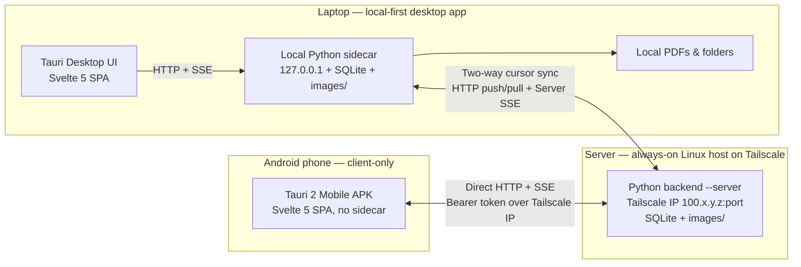

# Mobile app (Android) and two-way sync plan

> Status: **approved by the user (2026-11-22).** This feature has no LearnHarness counterpart.
> It does not depend on M10 (practice sessions) or M11 (smaller features / later providers) and can
> be implemented before or after them.

## Overview

Add an **Android mobile client** (Tauri 2 Mobile, client-only) and **automatic two-way sync**
between two full Verstehen backends: the user's **laptop** (local-first, owns local PDFs/folders,
works fully offline or when the server is down) and an always-on **server** on the user's Tailscale
network.



- **What changes:**
  - Backend gains a standalone `--server` mode with per-device token auth, short-code pairing,
    a cursor-based two-way sync engine (`verstehen.sync`), and laptop-side SSH server provisioning
    + ChatGPT OAuth tunnel.
  - SQLite gets a non-breaking migration adding sync metadata (`sync_id` UUIDs on graph ledgers,
    `updated_at` on mutable rows, `owner_device_id` on `jobs`, plus `devices`, `sync_state`,
    `sync_log`, and `sync_tombstones`). Existing `verstehen.db` data upgrades cleanly in place;
    inner JSON payloads stay LearnHarness-compatible.
  - Frontend (`app/`) adapts to mobile viewports (drawer sidebar, bottom-sheet/tab right panel,
    touch-friendly question dock and `/graph`, SSE reconnect on app resume) and adds Settings → Sync
    / Server on desktop + a pairing screen on mobile.
  - `app/src-tauri/` splits desktop-only sidecar code behind `#[cfg(desktop)]`, adds
    `#[cfg(mobile)]` Android Keystore storage, and scaffolds Tauri 2 Android with a Tailscale-only
    cleartext network security config.
- **What the user notices:**
  - From the laptop UI, they add their Linux server (Tailscale IP + one-time SSH credentials),
    sign the server into ChatGPT via an automated tunnel, and mint an 8-character pairing code.
  - On Android, they install the signed `.apk`, enter the server's Tailscale IP:port and short code,
    and get live lessons, questions, side chat, and knowledge graph synced automatically with their
    laptop.
  - On the laptop, everything still runs locally and works offline or if the server is down; sync
    catches up automatically when the server is reachable.
- **Non-obvious effects:**
  - If implemented before M10 (practice sessions), M10 will need to register any new tables/columns
    it adds in `sync_log`.
  - Local PDFs/folders referenced on the laptop are not synced in v1: extracted content, summaries,
    plans, and `images/` sync to mobile and remain readable, while re-reading raw laptop file paths
    only works on the laptop.

## Locked-in user decisions

Every item below was explicitly decided by the user and must not be changed without asking:

1. **Two-backend + thin mobile topology:** Laptop runs its full local backend (local SQLite, local
   files/PDFs, offline-capable); Server runs the same Python backend as an always-on hub; Mobile is
   client-only talking exclusively to the Server.
2. **Mobile target:** **Tauri 2 Mobile, Android only** for v1 (signed `.apk`, no iOS target yet).
3. **Tailscale IP directly (no `tailscale serve`):** Android and laptop connect directly to the
   server's Tailscale IP (`http://100.x.y.z:<port>`). Android's `network_security_config.xml`
   allows cleartext HTTP only for Tailscale's CGNAT range (`100.64.0.0/10`), keeping public
   cleartext blocked; WireGuard encrypts transport underneath.
4. **Auth & pairing:** **Per-device tokens** (stored SHA-256 hashed on the server, individually
   revocable). Pairing uses a **short one-time code** (e.g. 8 chars, 5-minute expiry, single-use)
   entered manually on Android—no QR scanner in v1.
5. **Server setup & provider sign-in (laptop UI only for v1):**
   - Laptop UI installs the backend on the Linux server over SSH using user-supplied host/user/password
     (SSH password used once in memory during setup, never stored on disk).
   - Server ChatGPT OAuth runs from the laptop UI over a temporary SSH port-forward
     (`127.0.0.1:1455` → server `127.0.0.1:1455`) so the server gets its own independent refresh
     token.
   - **Claude Code on the server** is installed and signed in separately by the user; desktop UI
     shows its status read-only.
6. **Offline session conflict:** **Fork on conflict.** If the same session was edited offline on
   both laptop and server, keep the server's timeline in the original session and duplicate the
   laptop's diverging branch as `"<Title> (Laptop copy)"`. Never lose messages.
7. **Active turn / compaction during sync:** Never apply incoming remote entries to a session whose
   `SessionRuntime` holds an active `run` or `compaction`. Hold/queue incoming changes for that
   session and apply once `turn-settled` / `compaction-changed` leaves it idle.
8. **Deletes:** **Immediate propagation via `sync_tombstones`** (no soft-delete / Trash window).
9. **Local PDFs / files from mobile:** Leave as-is for v1 (synced lesson entries + `images/` are
   readable on mobile; raw laptop paths remain laptop-only).
10. **Prompt overrides (`<data dir>/prompts/`):** Synced between laptop and server.

## Safety and correctness rules

All 8 rules below are required in the sync implementation:

1. **Idempotent push/pull (flaky Wi-Fi safe):** Every sync write is idempotent (`INSERT OR IGNORE`
   by `entry_id`, `sync_id`, `request_id`, plus `(device_id, client_seq)` deduplication on the
   server) so retrying a partially acknowledged push never duplicates rows.
2. **Schema version gate:** Every push/pull carries `schema_version` (latest applied migration
   number). On mismatch, sync pauses cleanly with an `"update_required"` status rather than
   applying incompatible payloads.
3. **Server-sequence ordering (no clock-skew bugs):** Mutable LWW fields (`settings`, session
   renames, `artifact_views`, `graph_positions`, `graph_source_placements`) order by server-assigned
   `server_seq` rather than trusting raw client wall clocks.
4. **Images transferred before SQLite commit:** Missing `<data dir>/images/<sha256>.<ext>` blobs
   are uploaded (on push) or downloaded (on pull) *before* committing the SQLite transaction that
   references them.
5. **No double graph extraction, titling, or idle wakes:** Sync-applied writes pass
   `from_sync=True` so they never append back into `sync_log` and never trigger local automatic
   graph extraction, title generation, or idle delivery wakes. Only the backend that actually ran
   the turn triggers those, then syncs the results.
6. **Model/account mismatch:** Keep Verstehen's existing no-fallback behavior. If a synced session's
   pinned model/account isn't available on the server, resolution returns `503 model_unavailable`
   and the UI opens the model menu.
7. **Running background jobs (`research`, `demo`, `visual`, `pdf`):** Tag `jobs` with
   `owner_device_id` so the recovery sweep in `session/jobs.py` only recovers jobs owned by the
   local device, and only sync jobs once settled (`done` / `error`).
8. **Strict sync allowlist (no credential leakage):**
   - **Synced:** `sessions`, `entries`, `side_threads`, `side_exchanges`, settled `jobs`,
     `artifact_views`, `usage`, `graph_*` ledgers/positions/placements, shared lesson settings
     (quizzing, compaction limit, graph render settings, prompt switches), `images/<sha256>.<ext>`,
     and `prompts/*.md`.
   - **Never synced:** `credentials.json`, Claude Code login, `file_access` allowed paths,
     `demo_browser` path, `logs/`, `browsers/`, and machine-specific model slot defaults.

## Sync protocol

- **Changelog (`sync_log`):** Every local write to a synced table appends a row
  `(change_seq INTEGER PRIMARY KEY AUTOINCREMENT, entity, op, payload, origin_device_id, origin_seq)`
  inside the same SQLite transaction.
- **Bookmarks (`sync_state` on laptop):** Stores `device_id`, `server_url`, `last_pushed_seq`,
  `last_pulled_seq`, and last sync status/error.
- **Push triggers (laptop → server):**
  - Debounced (~300 ms) after any local commit settles (`turn-settled`, session/side-chat/graph/
    settings/prompt mutation). Never mid-stream during token generation.
  - On app startup and on reconnect with exponential backoff (5s → 15s → 30s → 60s) when offline.
- **Pull triggers (server → laptop):**
  - Real-time via a persistent background SSE connection from laptop `SyncService` to Server
    `GET /api/events` (reacting to `sync-changed`).
  - On app startup / wake / SSE reconnect.
  - 60-second fallback timer.
- **Apply flow (laptop):**
  1. Fetch changes after `last_pulled_seq`.
  2. Download any missing referenced `images/<sha256>.<ext>` blobs.
  3. Partition changes by session: hold aside any session whose `SessionRuntime` has an active
     `run` or `compaction` (apply once idle).
  4. Apply ready changes in one SQLite transaction (`from_sync=True`) and advance
     `last_pulled_seq` atomically.
  5. Emit local `/api/events` (`chats-changed`, `graph-changed`, `jobs-changed`,
     `side-chats-changed`) so the open desktop UI refreshes live.

## Package layering

Update `import-linter` in `backend/pyproject.toml` so `verstehen.sync` sits alongside `session` or
just below `api`:

```
api  →  sync  →  session  →  jobs | sidechat | graph  →  teaching | providers  →  store
```

`sync` reads `SessionRuntime` lock/idle state from `session` and persists via `store`; `session`
signals `SyncService` only via an injected callback wired in `app.py` (matching existing callback
injection for `wake_session` and `graph_changed`).

---

## Milestones

### Milestone A — Server mode, per-device auth & short-code pairing (implemented on `mobile-sync-a`)

*Goal: The Python backend runs standalone on a Tailscale IP, authenticates per-device tokens, and
pairs new devices via a short one-time code. Detailed plan: [mobile-sync-a.md](mobile-sync-a.md).*

- **Schema & store:**
  - New migration (`0007_devices.sql` or combined with `0007_sync.sql`): `devices` table
    (`id`, `name`, `token_hash`, `created_at`, `last_seen_at`, `revoked_at`).
  - `backend/src/verstehen/store/devices.py`: `DevicesStore` (create, verify SHA-256 token in
    constant time, touch `last_seen_at`, list, revoke).
  - In-memory short-lived pairing code manager (8-char code, 5-minute TTL, single-use,
    rate-limited).
- **Server launch mode:**
  - `backend/src/verstehen/config.py`, `backend/src/verstehen/cli.py`: add `--server` /
    `VERSTEHEN_SERVER=1`, configurable `--host` / `VERSTEHEN_HOST` (e.g. Tailscale IP) and
    `--port` / `VERSTEHEN_PORT`; no stdin-EOF shutdown in server mode; bootstrap CLI flag or
    initial pairing token printout on first run.
- **Auth middleware & routes:**
  - `backend/src/verstehen/api/access.py`: server mode enforces `Authorization: Bearer <token>`
    (also accepting `x-verstehen-token`) against `DevicesStore`; exempts `/api/health` and
    `/api/auth/pair`.
  - `backend/src/verstehen/api/auth.py`:
    - `POST /api/auth/pairing-code` (authenticated → `{code, expires_at}`)
    - `POST /api/auth/pair` (`{code, device_name}` → `{device_id, token}`)
    - `GET /api/auth/devices`
    - `DELETE /api/auth/devices/{id}`
- **Tests:** Offline pytest suite covering server mode binding, token auth refusal/acceptance,
  pairing code expiry/single-use, and device revocation.

### Milestone B — Two-way Laptop ↔ Server sync engine *(implemented on `mobile-sync-b`; see [mobile-sync-b.md](mobile-sync-b.md))*

*Goal: Two Verstehen backends sync automatically over HTTP + SSE, offline-safe, satisfying all 8
safety rules plus fork-on-conflict and active-turn queueing.*

- **Schema migration (`store/migrations/0008_sync.sql`, or combined with A):**
  - Add `sync_id TEXT` (UUID, backfilled for existing rows) to `graph_nodes`, `graph_node_links`,
    `graph_chains`, `graph_coverage`, `graph_checkpoints`, `graph_sources`, `graph_source_folders`.
  - Add `updated_at TEXT` to `settings`, `artifact_views`, `graph_positions`,
    `graph_source_placements`.
  - Add `owner_device_id TEXT` to `jobs` (backfilled with local `device_id`).
  - Create `sync_state`, `sync_log`, and `sync_tombstones`.
  - Run `make lock-migrations`.
- **Store & job recovery updates:**
  - `store/sync.py`: `SyncStore` for `sync_state`, `sync_log`, `sync_tombstones`, idempotent apply
    helpers, and fork-on-conflict session cloning.
  - Existing stores (`sessions.py`, `entries.py`, `side_chats.py`, `jobs.py`, `artifact_views.py`,
    `usage.py`, `graph.py`, `settings.py`): append to `sync_log` on local writes within the same
    transaction; skip logging when `from_sync=True`; enforce the settings/table allowlist.
  - `session/jobs.py`: scope job recovery sweep to `owner_device_id == local_device_id`.
- **Sync routes & service:**
  - `backend/src/verstehen/api/sync.py` (server): `POST /api/sync/push`,
    `GET /api/sync/pull?since=<seq>`, `POST /api/sync/images/{sha256}.{ext}`. Emit `sync-changed`
    on `/api/events`.
  - `backend/src/verstehen/sync/service.py` (laptop): `SyncService` background task (debounced
    push, Server SSE listener + 60s fallback pull, backoff when offline, image transfer before DB
    commit, `prompts/*.md` sync, `SessionRuntime` lock/idle check + deferred queue, fork-on-conflict,
    local `/api/events` emit).
  - `backend/src/verstehen/api/sync_status.py` (laptop): `GET /api/sync/status`,
    `POST /api/sync/now`.
  - Wire in `backend/src/verstehen/app.py`.
- **Tests:** Two-backend pytest integration suite (two real FastAPI/SQLite apps in temp dirs):
  - Normal push/pull across sessions, entries, side chats, settled jobs, usage, graph ledgers,
    shared settings, `images/`, and `prompts/`.
  - Offline backlog catch-up and flaky/duplicate push idempotency.
  - `schema_version` mismatch pause.
  - Image upload/download before SQLite commit.
  - Immediate delete propagation via tombstones.
  - Active-turn / active-compaction deferral until idle.
  - Offline same-session divergence → fork-on-conflict (`"<Title> (Laptop copy)"`).
  - Verify synced writes do **not** trigger double graph extraction, auto-titling, or wakes, and
    never leak `credentials.json` or `file_access`.

### Milestone C — Desktop UI for Server SSH Install, Server Accounts & Device Pairing

*Goal: Install and manage the server, its ChatGPT sign-in, and paired devices entirely from the
laptop's Settings UI.*

- **Backend (`sync/provision.py`, `api/server_setup.py`):**
  - SSH installer (e.g. `asyncssh`): connects with Tailscale IP + username + password (in-memory
    only, never persisted), detects arch (`x86_64` / `arm64`), deploys the frozen server bundle to
    `~/.local/share/verstehen-server/`, writes & enables `~/.config/systemd/user/verstehen-server.service`
    with `loginctl enable-linger` bound to the server's Tailscale IP, mints the laptop's device
    token, and saves server URL + laptop token in local `credentials.json` / `sync_state`.
  - Server ChatGPT OAuth helper: opens temporary SSH local port-forward
    (`laptop 127.0.0.1:1455 → server 127.0.0.1:1455`), initiates server ChatGPT sign-in, opens
    `auth.openai.com` in the laptop browser, closes tunnel on completion.
  - Proxy endpoints for server status (`/api/accounts/claude-code`, `/api/accounts/chatgpt`,
    `/api/auth/devices`, `/api/auth/pairing-code`).
- **Frontend (`app/src/lib/components/settings-sync.svelte` + `app/src/routes/settings/+page.svelte`):**
  - **Add Server** form (Tailscale IP, port, SSH user, SSH password) + live install step log.
  - **Server Accounts:** Sign in with ChatGPT button + read-only Claude Code status badge (noting
    separate install/sign-in on server).
  - **Paired Devices:** "Pair Android device" button displaying Tailscale IP:port + 8-char code
    with expiry countdown, plus device list with Revoke buttons.
  - **Sync status indicator** (Synced / Syncing / Offline / Update required + "Sync now").
- **Verification:** Mocked-SSH pytest tests + Vitest component tests for sync/setup states +
  Playwright verify flow for Settings → Sync + `docs/feature-map.md` entry.

### Milestone D — Mobile-responsive SvelteKit UI & SSE resilience

*Goal: The existing `app/` SPA is comfortable on a phone screen and recovers cleanly from mobile
network drops and app backgrounding.*

- **Remote client & pairing (`app/src/lib/api/client.ts`, pairing route):**
  - Support remote server mode (server URL + bearer token loaded from Tauri mobile storage or web
    config) alongside existing desktop `sidecar_connection`.
  - Route to `/pair` on missing config or `401` (enter Tailscale IP:port + 8-char short code →
    `POST /api/auth/pair`).
- **Responsive layout (`app/src/routes/(lesson)/+layout.svelte`, question dock, composer, `/graph`):**
  - Sidebar collapses to a slide-over drawer on narrow viewports.
  - Right panel (Plan / Jobs / Side chat) adapts to a bottom sheet or full-screen tab switcher.
  - Touch-friendly Question Dock, Composer, safe-area insets (`env(safe-area-inset-*)`), and mobile
    keyboard handling.
  - `/graph`: pinch-zoom, touch pan, and tap/long-press node actions.
- **SSE reconnect:**
  - Auto-reconnect `/api/events` and active turn stream on `visibilitychange` / `online` + refetch
    session list and active session state so resuming the app never shows stale data.
- **Verification:** Playwright mobile-viewport (`390×844`) verify flows covering pairing, lesson
  turn, question dock, Plan/Side-chat sheet, and `/graph` + `docs/feature-map.md` entries.

### Milestone E — Tauri 2 Mobile (Android `.apk`) packaging & release

*Goal: Build a signed Android `.apk` from `app/` with Android Keystore token storage and Tailscale
HTTP access.*

- **Desktop/mobile Rust split (`app/src-tauri/`):**
  - Gate sidecar startup, `externalBin`, `sidecar_connection`, and `tauri-plugin-shell` behind
    `#[cfg(desktop)]`.
  - Add `#[cfg(mobile)]` commands for Android Keystore storage (`get_server_connection`,
    `save_server_connection`, `clear_server_connection`).
- **Android project & network security:**
  - Scaffold Android via `tauri android init`.
  - Add `network_security_config.xml` permitting cleartext HTTP **only** for Tailscale's
    `100.64.0.0/10` range (public cleartext stays blocked).
- **Build & CI:**
  - Add `make android` target and a GitHub Actions job building & attaching the signed `.apk` on
    tagged releases alongside the Arch package.
- **Verification:** Clean `.apk` build in CI + manual smoke test on the user's Android phone over
  Tailscale (pair with short code → run live lesson turn → verify sync on laptop).
